# System Architecture Document (SAD) — Entrepreneur Peers, Circles & Events

## Context & Instructions
Greenfield SAD produced by `@system.arch`, built step by step with the operator. **Status: complete SAD v1 (2026-11-15)**: all four steps done (`*decompose-work`, `*select-pattern`, `*define-controls`, `*create-sad` + `*define-eval-criteria`). It is the blueprint for Build; open items are listed under Open Questions.
This is the blueprint for Build-phase personas. Work ownership and the pattern decision come before any runtime roles; the app is not assumed to be a multi-agent crew or a chat interface.

## Input Requirements

**PRD Document**: `project-context/1.define/prd.md`
**MRD** (optional): `project-context/1.define/mrd.md`
**System Description** (when present): `project-context/1.define/system-description.md`
**User Stories** (when present): `project-context/1.define/user-stories/` (US-001 to US-024)
**MVP Scope**: the synthetic-data capstone. Must stories US-001 to US-015 make up the core journey; Should stories US-016 to US-022 follow if time allows.
**Selected Runtime**: crewai

## System Architecture Specification — Generate All Sections

### Work Ownership

Lens: a model's output is **probabilistic**, it has a **knowledge cutoff**, its **working memory is limited**, and it is only partly **steerable**. A step goes to the model only when variation in its output is tolerable, the step needs no live facts beyond what we pass in, the input fits a bounded context, and the output can be checked. Every rule, permission and live record stays in app code (the "existing system" for a greenfield build is the app's own backend and database).

| Step | Owner (model / existing system / human / collaborative) | Reversibility | Stakes | Accountable party | Rationale |
|------|----------------------------------------------------------|---------------|--------|-------------------|-----------|
| W01 Log in as a synthetic persona (US-001) | existing system | Reversible | Medium: the identity behind every authorization check | Builder (backend) | Deterministic session issuance; the actor must come from the server (MN-011) |
| W02 Create or edit profile, set faith matching opt-in (US-002) | human | Reversible | Medium: self-disclosure | Participant | Only the person can describe themselves; the system validates the stage value and blocks sensitive fields (MN-012) |
| W03 Set directory or event-reconnection consent (US-003, US-004) | human | Reversible | High: controls who can see me | Participant | Consent cannot be inferred or delegated (MN-001) |
| W04 Enforce visibility (directory, filters, reconnection lists) | existing system | Reversible | High: a privacy leak cannot be undone | Builder (backend) | Pure rules over live consent, block and attendance records; must be exact, not probabilistic |
| W05 Filter-based discovery (US-005) | existing system | Reversible | Low | Builder | Deterministic query; it is also the fallback when AI is unavailable (MC-005) |
| W06 Choose which candidates the AI may see | existing system | Reversible | High: decides what data reaches the model | Builder (backend) | Eligibility (opted in, not self, not blocked, capped at 50, minimised fields, faith only with the user's opt-in) is a rule, not a judgement, and the model must never be its own gatekeeper (MN-004, MC-002) |
| W07 Rank candidates and write a reason for each (US-006) | **collaborative**: the model drafts, the participant decides | Reversible: only a list on screen | Low to medium: bad suggestions waste time; a misleading reason could erode trust | Participant (decides); builder (eval gate) | The only step that needs judgement over fuzzy text (interests, challenges); variation is tolerable because a human decides and an eval measures quality (MP-003) |
| W08 Check each suggestion is grounded and eligible before display | existing system | Reversible | Medium | Builder | A deterministic check that each cited field really exists on both profiles and each id is in the W06 set; it catches model errors (AC-007, AC-008) |
| W09 Send or withdraw a connection request (US-007) | human | Reversible (withdraw) | Medium: unwanted approaches | Sender | A social act; the AI has no write path (MN-003) |
| W10 Accept or decline a request (US-008) | human | Partly reversible (block later) | Medium | Recipient only | Consent belongs to the recipient (AC-003) |
| W11 Grant or revoke contact sharing (US-009) | human, both parties | **Irreversible once seen**: copied contacts cannot be recalled | High | Each participant | Highest-stakes consent in the product; both sides must grant it explicitly (MN-002) |
| W12 Block or report (US-010) | human; the admin reviews reports | Block is reversible; a report is a record | High: safety | Participant; admin | Safety decisions stay human; enforcement of a block is deterministic (W04) |
| W13 Draft and submit an event (US-012) | human (organiser) | Reversible until published | Medium | Organiser | Content and curation stay human-led (PRD-v0 §2) |
| W14 Approve or reject an event (US-013) | human (admin) | Reversible (unpublish), but exposure while live cannot be undone | High: public publication | Admin | The operator's human gate (MD-011); the AI never approves (MN-003) |
| W15 Enforce the publication gate (listing, detail, link, API) | existing system | n/a | High | Builder (backend) | No event is published without an approval record (AC-006) |
| W16 Register or withdraw; confirm attendance (US-014, US-015) | human (participant; organiser or co-host) | Reversible, and corrections are recorded | Medium: attendance gates reconnection | Participant; organiser | Attendance is a fact only a person present can assert; registration is never attendance (MN-007) |
| W16b Late attendance: "I was there" claim → organiser approves or declines; or event-code entry (US-025) | human (the organiser decides claims) / existing system (validates codes) | Reversible (the organiser can remove anyone) | Medium: attendance unlocks the attendee list | Organiser; builder | Who was present is a human fact. A code is a host-issued shortcut that code checks (window, rate limit, rotation); the model is never involved (MD-023, MD-024) |
| W17 Join or leave a circle; approve join requests (US-011, US-016) | human (participant; facilitator) | Reversible | Medium | Participant; facilitator | Policy is enforced by the system, decisions are made by humans |
| W18 Curate venues; tag faith-context circles (US-017, US-020) | human (admin or facilitator) | Reversible | Low | Admin | Unknown fields must stay "Unknown"; a model would invent values (MN-010) |
| W19 Follow-up self-report (US-021) | human | Reversible (edit); idempotent | Low | Pair members | It is a self-report by definition |
| W20 Compute funnel metrics (US-022) | existing system | Reversible | Medium: misleading numbers | Builder | Counting must be exact and auditable (MP-005); never model-generated |
| W21 Turn free text into drafted profile tags and a one-line summary (US-024) | **collaborative**: the model drafts, the participant edits, accepts or discards | Reversible: nothing is saved until accepted | Medium: a wrong or inferred tag (for example faith) misrepresents a person | Participant (accepts); builder (eval gate MP-007) | Summarising fuzzy free text is model work; variation is tolerable because the author reviews every field before it is saved (MN-013) |
| W22 Check the draft before display: tags trace to source words, no faith or sensitive tags, schema-valid | existing system | Reversible | Medium | Builder | Deterministic check, the same idea as W08 (MN-014) |
| W23 Save accepted fields with per-field visibility; delete raw text; enforce *matching only* | existing system | Raw-text deletion is irreversible by design | High: hidden fields must stay hidden | Builder (backend) | Visibility is a rule, so it lives in code (MD-020, MN-015) |

The editable source of this figure is `project-context/diagrams/system-arch/work-ownership.html`.

**Feasibility verdict**: `feasible with constraints`
**Load-bearing constraint**: the model owns exactly two steps, both drafts that a person reviews: W07 (rank and explain suggestions) and W21 (draft profile fields from the author's own free text). W07 receives only the candidate set the server has already filtered and minimised (W06). W21 sees only the author's own text, and its output is saved only when the author accepts it. Neither has a write path to any record. Every access, consent, publication and counting decision is deterministic code or a human decision. If this constraint is relaxed, for example by letting the model choose who is eligible, the privacy guarantees in MP-001 can no longer be proven by tests.

### Pattern Decision

The decision covers the two model-owned steps, W07 (suggestions) and W21 (profile assistant, added 2026-11-14). Everything else is ordinary application code and has no pattern to choose. W21 is assessed after the W07 table.

| Factor | Augmented call | Workflow | Agent |
|--------|----------------|----------|-------|
| Predictability | The path is fixed: filter → one call → check | Same path, with more model steps to vary | The model chooses its next step, which is unnecessary when the path is already known |
| Error cost | Low: a bad list is caught by W08 or ignored by the user | Low | Higher: tool calls can reach live data |
| Observability | One prompt, one response, one trace | Several traces per request | Variable-length traces |
| Latency (p95 ≤ 15 s, MC-003) | One round trip | Two or more round trips | Unbounded without caps |
| Cost (≤ US$0.05 per request, ≤ US$20 total) | One call | About 2× per request (evaluator-optimizer) | Several calls per request |

- **Primary shape**: `augmented call`
- **Workflow sub-shape** (when applicable): n/a
- **Deciding factor**: **predictability.** The path can be written out in full in advance: code filters the candidates (W06), one model call ranks them and writes reasons (W07), and code checks the result (W08). Because the path is fixed, an agent is ruled out on the first factor; agents are legal only when the path cannot be enumerated. Among the shapes that remain, a workflow adds a second model step whose only job would be to judge the first. W08 already does that deterministically, at no model cost, and more reliably. So a workflow adds cost and latency and nothing else.
- **"Augmented" means** the call receives everything it needs in its prompt: the viewer's minimised profile, at most 50 eligible people and at most 20 visible circles, all chosen by code. It returns structured output, a list of `{candidate_id, kind, reason, cited_fields[]}`, which is validated against a schema. It has no tools and no retrieval.
- **Peers and circles in one call**: both lists go into a single call, which fits the per-request cost cap. Splitting them into two parallel calls would make this a parallelization workflow and double the cost.
- **Retry**: one retry, only when the output fails schema validation. On a second failure, or on timeout or budget breach, the request falls back to filter discovery (MC-005).
- **Rejected alternatives and reversal cost**:
  - *Workflow, evaluator-optimizer* (a second model call that critiques and revises the first): rejected because it about doubles cost and latency, and the deterministic W08 check covers the failures that matter (eligibility, grounding, faith leakage). **Reversal cost: low.** It would mean adding one task to the crew config, with no data-model change. Reconsider if evals show reasons are grounded but unhelpful.
  - *Agent with tools* (the model queries profiles itself): rejected because it would let the model act as its own gatekeeper for who is eligible. That breaks the load-bearing constraint from Work Ownership, and the privacy tests (MP-001) could no longer prove the boundary. **Reversal cost: high.** The access-control and eval design would need to be redone.
  - *Embedding similarity with no LLM*: considered and kept only as a possible future cost optimisation. It cannot produce the human-readable reason that MD-005 requires.
- **Progression used**: prompt only → no tools and no retrieval → no evaluator-optimizer, because the deterministic check (W08) takes that role → fine-tuning not considered.
- **Runtime fit (crewai)**: the call is hosted as a CrewAI crew with **one agent, one task and no tools**, run sequentially with `allow_delegation=false`, `output_pydantic` for the schema, a `Task.guardrail` that runs the W08 checks, `max_iter` of 1–2 (a single call plus at most one schema retry), memory=False and low temperature. This keeps the adapter conventions (agents and tasks in YAML, externalised config) without implying a multi-agent design. Swapping CrewAI for a direct SDK call later would be a small change limited to one module.

**W21 profile assistant: also an `augmented call`.** The path is fixed: the author submits text, one call drafts `{interests[], challenges[], looking_for[], industry?, summary}` against the tag vocabulary, the W22 code check runs, and the author reviews. *Deciding factor: predictability*, the same as W07. It is a textbook extraction task with a human reviewer, so an agent or workflow adds nothing. It is hosted as a second one-agent, one-task, tool-free crew (`profile_assistant`), separate from the suggestion crew, so that each has its own prompt, eval (MP-007) and trace. Merging the two into one crew would make them a workflow and couple two failure modes. *Reversal cost: low.*

Agent-only fields (tool allowlist, turn budget, stop conditions): **n/a**, because the pattern is not agent. The equivalent bounds for this call are: no tools, at most 2 model invocations per request, and stop on valid output, a second schema failure, a timeout, or budget breach.

### Reference Architecture

The editable source of this figure is `project-context/diagrams/system-arch/reference-architecture.html`.

- **Selected reference architecture**: **document pipeline**, which means structured extraction with an exception path. It is the closest proven shape: code assembles a bounded input, a single model call turns it into structured records (ranked suggestions with cited fields), the output is validated against a schema and checked for grounding, and anything failing goes to an exception path (dropped suggestions, or fallback to filter discovery).
- **Known failure this design prevents**: *no exception path.* Prevented by the W08 guardrail, which drops ungrounded or ineligible items, and by MC-005: filter discovery still works when the call fails, times out or exceeds budget.
- **Also explicitly avoided**: *retrieval used as a substitute for live state.* Consent, blocks and attendance change at any moment, so candidates come from a live database query at request time, never from a precomputed vector index of profiles. An index could serve a profile after its owner opted out.
- **W21 profile assistant** fits the document-pipeline shape even more directly: free text → structured fields → validation → human review as the exception path. The same known failure, *no exception path*, is prevented by W22 and by manual tag entry as the fallback (MC-006).
- **Second pattern**: none. Both model steps share one pattern and one reference architecture.

### Model and Context Strategy

- **Default model tier**: balanced. **Proposed: Claude Sonnet 5.5 (`claude-sonnet-5-5`) at `effort: low` for both crews, pending operator confirmation (OQ-A02).** Sizing per suggestion request, estimated (to be confirmed with token counting in Build): about 8.5K input tokens (system prompt about 1K, viewer about 0.2K, 50 people × about 120 tokens, 20 circles × about 60 tokens) and about 2.5K output tokens including thinking (top 10 suggestions, reasons ≤ 25 words each).

  | Model | Price in / out per 1M tokens | Est. cost per suggestion request | Fits ≤ US$0.05? |
  |-------|------------------------------|----------------------------------|-----------------|
  | Claude Haiku 5.5 (`claude-haiku-5-5`) | $0.10 / $0.50 | ≈ $0.002 | Yes, with wide margin; quality must be proven by MP-003 |
  | Claude Sonnet 5.5 (`claude-sonnet-5-5`) | $2.00 / $10.00 | ≈ $0.042 | Yes, but tight; output length must be bounded |
  | Claude Opus 5.5 (`claude-opus-5-5`) | $4.00 / $20.00 | ≈ $0.084 | **No**; would need the candidate cap cut to about 20, or a higher cap |

  Profile assistant (W21), estimated about 1K in and about 1.5K out: Sonnet 5.5 ≈ $0.017, Haiku 5.5 ≈ $0.001. The MC-006 proposal of ≤ US$0.01 holds only on Haiku 5.5, or on Sonnet 5.5 with output kept below about 0.8K tokens. Prices are list prices from the `claude-api` skill reference (cached 2026-10-06) and must be re-checked before Build.
- **Context strategy**: progressive. Each call gets only what its step needs, assembled by code at request time. There is no conversation history, no memory and no retrieval index.
- **Swap-as-release rule**: every change of model, effort level or prompt version is a release. It must re-run the relevant eval (MP-003 or MP-007) and meet these rollback criteria, written before the swap: roll back if relevance falls below 80% of gold-set agreement, if any eligibility, grounding or faith-leak case fails, or if p95 latency or cost per request exceeds MC-003 or MC-004.
- **Entry point**: direct API, called through CrewAI's model layer (LiteLLM) inside the backend. There is no hosted chat, agent SDK or MCP server.
- **Entry-point tradeoff named at decision time**: CrewAI gives YAML-externalised agents and tasks, `output_pydantic` and `Task.guardrail`, all of which the adapter rules require. The cost is a dependency on LiteLLM passing current Claude parameters correctly. Two known risks for Build to verify (OQ-A03): (1) the 5.5-generation models reject `temperature`, so no temperature may be set anywhere in the crew config; (2) native structured outputs and the `effort` setting may not pass through LiteLLM. If they don't, the schema is still enforced by `output_pydantic` plus one retry (CR-005).
- **Entry-point responsibility map**: one route only (backend → CrewAI → Anthropic API). The browser never calls the model.
- **Minimum data in the context window**:
  - *Suggestion crew (W07)*: the viewer's MD-021 matching fields; for each candidate, a short opaque id plus their MD-021 fields; for each circle, an id, purpose and tags. **Never**: names, contact fields, raw free text, faith when its opt-in is off, block or consent state, event attendance lists, or any field set to "shown on profile" that is not also an MD-021 field.
  - *Profile assistant (W21)*: the author's own free text (≤ 1,500 characters), the fixed tag vocabulary, and the output schema. Nothing about other users.
- **Identity**: enforced in server-side code (CR-011). The prompt never carries authorization decisions, and the model is never asked whether someone may see something.
- **Determinism note (adapter deviation)**: the CrewAI adapter asks for low temperature, but `temperature` is rejected on the 5.5-generation models. Determinism is instead achieved through `effort: low`, structured output, a pinned prompt version and a pinned model id. This deviation is recorded in Audit.

### Control Register

How user-written text reaches the two prompts, which is why injection controls CR-003, CR-004 and CR-015 exist:

The editable source of this figure is `project-context/diagrams/system-arch/user-text-paths.html`.

What training already reduces, and the app does not rely on alone: general refusal of harmful content, and basic instruction-following on "treat this text as data". What the app must enforce itself: everything below.

| ID | Risk category | Control | Control point (input / output / tool-call) | Failure direction (fail closed / fail open) | Owner | Evidence artifact | Review routing |
|----|---------------|---------|--------------------------------------------|---------------------------------------------|-------|-------------------|----------------|
| CR-001 | Data exposure | Candidate eligibility filter (W06): only opted-in, not self, not blocked in either direction, capped at 50 people and 20 circles, evaluated live at request time | input | fail closed: on error, no model call; fall back to filter discovery | backend.eng | Tests for AC-001, AC-005, AC-007 | None; deterministic |
| CR-002 | Data exposure / minimisation | Field allowlist serializer: only MD-021 fields are placed in the prompt; faith only when its opt-in is on; contact data, names and raw text excluded; unknown fields dropped | input | fail closed | backend.eng | Tests for AC-008, AC-019; prompt-trace audit sample | None |
| CR-003 | Direct injection | User-authored text (bio ≤ 200 chars, assistant free text ≤ 1,500 chars) is wrapped in delimiters as data; the system prompt says to ignore instructions inside it; tags come from a fixed vocabulary | input | fail closed: over-length input is rejected before the call | backend.eng | Adversarial cases in the MP-003 and MP-007 evals | Eval failure blocks release |
| CR-004 | Indirect injection | A candidate's bio inside *another viewer's* prompt (for example "rank me first") cannot widen eligibility or reveal data, because output is limited to ids from the input set (CR-006). Ranking skew is the residual risk | output | **fail open**: a skewed ranking is still shown, because it is low-stakes, reversible and the user decides. Mitigated by eval cases and trace flags | qa.eng | Injection-bio cases in MP-003 | Flagged traces reviewed during the eval cycle |
| CR-005 | Malformed output / refusal | Pydantic schema validation; `stop_reason` checked (refusal or max_tokens counts as a failure); one retry, then fallback | output | fail closed: no partial list is shown | backend.eng | Schema-failure and fallback tests (AC-009) | None |
| CR-006 | Hallucination / data exposure | Grounding and eligibility guardrail (W08): every id must be in the input set; every `cited_field` must exist on both profiles; eligibility is re-checked at display time to catch opt-outs during the call | output | fail closed per item: an invalid item is dropped, and if all are dropped the user sees the fallback | backend.eng | Tests for AC-007 plus the MP-003 grounding metric | None |
| CR-007 | Sensitive-attribute leakage | Faith and sensitive-term check on suggestion reasons and assistant tags: no faith reason unless both users opted in; no faith, health or family tag from the assistant | output | fail closed: the item or tag is dropped | backend.eng | Tests for AC-008 and AC-018; MP-003 and MP-007 cases | None |
| CR-008 | Tool abuse | Both crews are configured with **zero tools**; a startup check refuses to boot if any tool is bound | tool-call | fail closed: the service does not start | backend.eng | Config test; crew YAML review | None |
| CR-009 | Unauthorised side effect | Model output is never written to profile, request, membership or event tables. Assistant drafts live only in the user's session until they accept; suggestions are not persisted except in trace logs | tool-call (side effect) | fail closed | backend.eng | Tests for MN-003, MN-013, AC-017 | The user reviews every draft |
| CR-010 | Token-budget exhaustion / cost | Input caps (CR-001, CR-003); `max_tokens` cap per call; per-user limit (proposed: 10 suggest and 10 summarise actions per hour); a global spend counter switches AI off at US$20 | input | fail closed: AI off, fallback on, a clear message to the user | backend.eng / devops.eng | Spend log; rate-limit test | Operator alerted when the breaker trips |
| CR-011 | Identity spoofing | The actor comes from the server session; client-supplied ids are ignored; the prompt never makes authorization decisions | input | fail closed | backend.eng | Test for MN-011 (forged actor id) | None |
| CR-012 | Fairness injection points | *Prompt framing*: no ranking by stage seniority, industry prestige or faith; *examples*: balanced across stages and industries; *corpus*: the synthetic gold set covers all three stages and is modelled on public patterns (OQ-A01); *routing*: not applicable, one route | input / output | n/a; measured, not gated per request | qa.eng | MP-003 results broken down by stage and by faith opt-in | An eval disparity above threshold blocks release (threshold in `*define-eval-criteria`) |
| CR-013 | Decision log | Every model call logs trace id, prompt version, model id, effort, input candidate ids (not content), output ids, dropped items with reasons, tokens, cost and latency | output | **fail open**: a logging failure does not block the user, but it raises an alert | backend.eng | `project-context/2.build/logs` traces | Used to reconstruct any suggestion |
| CR-015 | Data exposure via reason text | A candidate's *matching only* fields may influence ranking but must never appear in the reason shown to the viewer. The prompt splits each candidate into `citable` (shown-on-profile) and `rank_only` (matching-only) groups; the validator requires `cited_fields` ⊆ citable fields on both profiles, and drops any reason containing a `rank_only` tag value | output | fail closed per item | backend.eng | Test for AC-019 extended to reason text; MP-003 leak cases (paraphrase leakage is a residual risk, eval-gated) | Eval failure blocks release |
| CR-016 | Staff access to *matching only* fields | A server-side scope check: the admin can see all; a facilitator only for members and pending applicants of their own circle; organisers and other participants never. Every staff view writes an access-log entry (viewer, subject, fields, time) | tool-call (data read) | fail closed: on scope or log failure the fields are not returned | backend.eng | Tests for AC-020, including a forged circle id and an organiser attempt | Admin can review the access log; unusual facilitator access is flagged |
| CR-017 | Attendee-list exposure via late attendance | The reconnection list is returned only for `confirmed` attendance. Codes are stored hashed, valid until 7 days after the event ends, and can be rotated or disabled by the organiser; wrong attempts are limited to 5 per hour per user; the organiser sees and can remove anyone who joined by code; claims and codes work only on approved events | tool-call (data read / side effect) | fail closed: an expired, disabled or wrong code, or a pending or declined claim, returns no attendee data | backend.eng | Tests for AC-021, AC-022, AC-023, including a code used after expiry and brute-force attempts | The organiser reviews claims and the code-joined list; a forwarded code is the residual risk, mitigated by rotation |
| CR-014 | Unapproved publication (human gate) | An event moves to published only with an admin approval record; enforced in the API, not only the UI | tool-call (side effect) | fail closed | backend.eng | Test for AC-006 | **Every** event goes to the admin, who sees the full event and the organiser |

The editable source of this figure is `project-context/diagrams/system-arch/control-layers.html`.

Review routing summary: suggestions have no queue, because they are reversible and low-cost and the user is the reviewer. Every profile-assistant draft is reviewed by its author. Every event is reviewed by the admin, because publication is high-stakes. User reports go to the admin with the reporter's reason attached.

### Production Shape

- **Volume**: the *capstone* volume is a handful of synthetic users, and the main spend is evals. The estimate is about US$6–10 of the US$20 cap on Sonnet 5.5: roughly 30 gold cases × 5 iterations × 2 crews. The *expected* volume for a possible beachhead pilot (not approved) is about 100 participants × 2 suggestion requests a week ≈ 200 requests a week, or ≈ US$8.40 a week on Sonnet 5.5 and ≈ US$0.40 a week on Haiku 5.5. The spend breaker (CR-010) must be re-set before any pilot.
- **Latency**: the p95 target is ≤ 15 s (MC-003). The main driver is output length, so the design keeps output to 10 suggestions with reasons of ≤ 25 words at `effort: low`, and the UI shows a loading state. p95 must be measured in Build; if it misses the target, reduce the output length before changing the model.
- **Retries, fallback chain, circuit breaker**: the SDK or LiteLLM retries 429, 5xx and connection errors with backoff (at most 2 retries); one schema retry (CR-005); overall timeout of 20 s per request. Fallback chain: AI suggestions → filter discovery (suggestions) and AI draft → manual tag entry (assistant). Circuit breaker: 5 consecutive model failures within 5 minutes switch the AI off for 10 minutes. The spend breaker switches it off at US$20.
- **Failure mode specific to this architecture (document pipeline)**: *structurally valid but wrong output*, meaning invented ids, invented shared fields or stale eligibility. Mitigation: CR-006, including the display-time re-check for someone who opts out while the call is running.
- **Per-request traces versus aggregate dashboards**: per-request trace records (CR-013) answer "why did this person see this suggestion?". They are stored as JSON lines under `project-context/2.build/logs` for the capstone. A separate aggregate view answers "is the system healthy?": daily spend versus cap, p95 latency, fallback rate, schema-failure rate, dropped-item rate by reason, and assistant accept/edit/discard rates. The aggregate view is built from the traces and never shows profile content.

### 1. MVP Architecture Philosophy & Principles

**MVP Design Principles**:

- **Feedback first**: the capstone proves the mechanics on synthetic data (MP-001 to MP-007). Real-user feedback is the owner-run manual experiment, which sits outside the app (mrd.md).
- **Simplest orchestration**: two augmented calls, each in its own one-agent, tool-free crew; everything else is ordinary request/response code (Pattern Decision).
- **Privacy is enforced in code, before the model**: every visibility, consent, eligibility and staff-access rule is server-side (CR-001, CR-002, CR-011, CR-016).
- **Observable by default**: per-request traces for model calls (CR-013), structured app logs, and a `/healthz` endpoint.
- **Deploy scaffolding from day 1**: containerised backend, Vercel frontend, CI for lint, test and build (§5).

**Core vs Future Features**:

- **MVP (Must, US-001 to US-015, US-023, US-024)**: persona login; onboarding; the profile assistant; per-field visibility; the opt-in directory; event reconnection; filter discovery; AI suggestions; requests; contact sharing; block and report; circles; event submission and admin approval; registration and attendance.
- **MVP (Should, US-016 to US-022)**: facilitator tools, faith-tagged circles, co-hosts, event-to-circle links, the venue directory, follow-up reports, and funnel metrics. They are built after the Must path passes end to end.
- **Future**: everything in PRD §4 P2. This includes real users and production authentication, booking and payments, chat and notifications, external connectors, recurrence, mentorship, and native mobile.

**Technical Architecture Decisions**:

- **Frontend: Next.js (App Router) + TypeScript**, chosen by the operator 2026-11-14. It suits a responsive, multi-role, multi-page web app; the frontend tooling supports it well; and it deploys natively to Vercel.
- **Backend: Python 3.12 + FastAPI**. CrewAI is Python, so the API and the crews share one process and one language; FastAPI gives typed request and response schemas (Pydantic) shared with `output_pydantic`.
- **Database: Supabase Postgres**, chosen by the operator 2026-11-14, reached **only from the backend**. The browser never talks to Supabase (see §8).
- **UI approach**: forms, lists and review screens. This is **not a chat interface**. The two AI touchpoints are a "Suggest" button that returns a ranked list with reasons, and a "Summarise" button that returns an editable draft.
- **Runtime communication**: synchronous JSON over HTTPS for every endpoint. **No streaming in the MVP.** The suggestion call returns one structured result and shows a loading state (p95 ≤ 15 s); streaming partial JSON would complicate the W08 checks for little gain.

### 2. Application Runtime Specification

The Pattern Decision requires two model calls on separate paths, so there are two runtime roles. Neither has tools or memory.

**Runtime roles**:

| Crew | Agent role and goal | Tools | Memory / session |
|------|---------------------|-------|------------------|
| `suggestion_crew` | *Peer and circle matcher*: rank the provided candidates for the viewer and give one grounded reason each | none (CR-008) | none; stateless per request |
| `profile_assistant_crew` | *Profile drafter*: turn the author's free text into tags from the fixed vocabulary plus a one-line summary | none (CR-008) | none; the draft is held in the user's server session until accepted (CR-009) |

**Task / Turn Orchestration**:

- **Flow**: API handler → deterministic input assembly (W06 or the assistant builder) → `crew.kickoff(inputs=…)` → `Task.guardrail` (W08 or W22) → response. There is one task per crew, so no task-to-task context chaining.
- **Expected outputs**:
  - `SuggestionResult { items: [{candidate_id, kind: "person"|"circle", reason (≤ 25 words), cited_fields: [str]}] (≤ 10) }`
  - `ProfileDraft { interests: [tag], challenges: [tag], looking_for: [tag], industry?: tag, summary (≤ 200 chars) }`
- **Errors**: guardrail failure or a schema miss leads to one retry; after a second failure, a timeout (20 s), a refusal or a budget-breaker trip, the request falls back (suggestions → filter discovery; assistant → manual tags). Cancellation: if the client disconnects, the result is discarded and still logged.
- **Budgets**: at most 2 model invocations per request; `max_tokens` about 3,000 for suggestions and about 1,500 for the assistant (output-bounded, MC-002, MC-006); per-user rate 10 per hour per action (OQ-A04); global spend breaker at US$20 (CR-010).

**Runtime-Conditional Configuration (crewai)**:

- `backend/app/crews/config/agents.yaml` and `tasks.yaml` hold one agent and one task per crew. `Process.sequential`, `allow_delegation: false`, `memory: false`, `max_iter: 2`, `max_retry_limit: 2`, `max_execution_time: 20`, crew-level `max_rpm` (proposed 30), and `output_pydantic` set to the schemas above.
- **Model**: `claude-sonnet-5-5` with `effort: low` (OQ-A02). **No `temperature`**, because 5.5-generation models reject it (adapter deviation, see Model and Context Strategy). The challenger eval runs the same config with `claude-haiku-5-5`.
- **Task ids and outputs**: `suggest_v{n}` and `draft_profile_v{n}`, with the prompt version in the id. Outputs are returned in memory, not written to files; the trace goes to `project-context/2.build/logs` (CR-013).
- **Startup check**: refuse to boot if any agent has tools bound, or if YAML references unknown fields (CR-008).

### 3. Frontend Architecture Specification

**Technology Stack**:

- Next.js (App Router) + TypeScript (strict), React Server Components where useful, and client components for forms. Styling and the component library are left to `@ux.designer` in `ux.md`; the SAD does not mandate a vendor library.
- State: server data through fetch with a typed API client generated from the backend's OpenAPI schema, and local form state in components. No global state store unless `ux.md` needs one.

**Application Structure** (routes are provisional; `ux.md` owns the final IA):

- `/login` (persona picker) · `/onboarding/[step]` · `/me/profile` (edit, assistant, visibility)
- `/directory` · `/discover` (filters + Suggest) · `/connections` (requests, contacts, blocks)
- `/circles`, `/circles/[id]` (facilitator view when permitted) · `/events`, `/events/[id]` (register, reconnection list) · `/events/new` (organiser)
- `/admin` (event approval queue, reports, venues, roles, staff-access log, metrics)
- **API client boundary**: one module, `lib/api/*`, built from OpenAPI types. The browser calls `/api/*` on the Vercel domain, and a Next.js rewrite proxies those requests to the backend, so the session cookie is first-party (a cross-site cookie with `SameSite=Lax` would not be sent). The frontend epic uses mocks; `@integration.eng` wires the real backend. The frontend never holds model or database credentials.
- **Components**: responsive from phone to desktop widths; WCAG 2.1 AA baseline (NFR-007); every page has empty, loading and error states.

**Interface Requirements**:

- Primary surfaces are the participant's discover and connect flows plus the admin queue, taken from the PRD; there is no chat.
- AI results are labelled "Suggested by AI" with their reasons; drafts are clearly editable and are not saved until accepted. Fallback messages appear when AI is unavailable (AC-009).
- "Synthetic data" is labelled site-wide (NFR-009). Future Work items (booking, chat, connectors) are visibly marked or absent.

### 4. Backend Architecture Specification

**API Architecture** (REST over JSON, FastAPI, OpenAPI published at `/openapi.json`):

| Area | Endpoints (indicative) | Notes |
|------|------------------------|-------|
| Session | `POST /session/persona`, `DELETE /session` | Synthetic login; sets an HTTP-only session cookie |
| Profile | `GET/PUT /me/profile`, `POST /me/profile/draft` (assistant), `POST /me/profile/draft/accept`, `DELETE /me/profile/draft` | Raw text deleted on accept or discard (MN-015) |
| Discovery | `GET /directory`, `GET /discover?filters`, `POST /suggestions` | `POST /suggestions` runs the suggestion crew |
| Connections | `POST/DELETE /requests`, `POST /requests/{id}/accept|decline`, `PUT /contact-shares/{connection_id}`, `POST /blocks`, `POST /reports` | Recipient-only accept (AC-003) |
| Circles | `GET /circles`, `POST /circles/{id}/join`, `DELETE /circles/{id}/membership`, `POST /circles/{id}/applications/{uid}/approve`, `GET /circles/{id}/members/{uid}/matching-fields` | The last endpoint is scoped and logged (CR-016) |
| Events | `POST /events`, `POST /events/{id}/submit`, `POST /events/{id}/registrations`, `PUT /events/{id}/attendance`, `GET /events/{id}/reconnect`, `PUT /events/{id}/reconnect-consent`, `POST /events/{id}/attendance-claims`, `POST /events/{id}/attendance-claims/{cid}/approve|decline`, `POST /events/{id}/checkin` (code), `PUT|DELETE /events/{id}/checkin-code` (organiser) | |
| Admin | `GET /admin/events/queue`, `POST /admin/events/{id}/decision`, `GET /admin/reports`, `GET /admin/users/{id}/matching-fields`, `GET /admin/access-log`, `CRUD /admin/venues`, `GET /admin/metrics` | Admin role only |
| Ops | `GET /healthz` | Unauthenticated liveness check |

- **Validation**: Pydantic request models; length caps (bio 200 characters, free text 1,500); tags validated against the vocabulary.
- **Rate limiting**: per session, 10 per hour on `/suggestions` and `/me/profile/draft` (OQ-A04); the global spend breaker (CR-010).
- **Error envelope**: `{ "error": { "code": "string", "message": "human-readable", "fallback": "filters|manual|null", "trace_id": "string" } }`. Authorization failures return 404 for resources whose existence is private (unpublished events, other people's requests) and 403 otherwise.

**Data Architecture** (Supabase Postgres; persistence is required by the PRD):

- Entities: `users` (persona, roles), `profiles`, `profile_fields` (value, visibility: `public|matching_only`), `discovery_consents` (global, per-event), `faith_matching_optin`, `connection_requests`, `connections`, `contact_shares`, `blocks`, `reports`, `circles`, `circle_memberships` (status: `member|applicant`), `circle_facilitators`, `events` (state machine: `draft→submitted→approved|rejected→cancelled`), `event_hosts`, `event_approvals`, `registrations`, `attendance` (status: `claimed|confirmed|declined`; source: `organiser|claim|code`), `event_checkin_codes` (hashed code, valid_until, active), `venues`, `follow_up_reports`, `staff_access_log`, `model_traces` (metadata only). The ER diagram is drawn in Build by `@backend.eng`.
- Access through SQLModel or SQLAlchemy with Alembic migrations. Authorization lives in the service layer (one policy module), not scattered across routes.
- **Supabase is used as plain Postgres.** Supabase Auth and auto-generated APIs are not used for the MVP. Row Level Security is **enabled with no policies** on every table, so the public anon key can read nothing. The backend connects with a server-only connection string.

**Runtime Integration Layer**:

- `app/ai/suggestions.py` and `app/ai/profile_assistant.py` each expose one function (`suggest(viewer_id)` and `draft(author_id, text)`). Each one assembles the input (W06 or the assistant builder), kicks off its crew, runs the guardrail, writes the trace, and returns a domain object or a typed fallback. The API routes never import CrewAI directly.
- Prompt Trace hook: a CrewAI step callback plus the wrapper write a redacted trace (ids, not profile content) per CR-013.

**Authentication & Secrets** (names only, in `.env.example`):

- Backend: `ANTHROPIC_API_KEY`, `DATABASE_URL` (Supabase Postgres, server-only), `SESSION_SECRET`, `AI_SPEND_CAP_USD` (20), `AI_MODEL_SUGGEST`, `AI_MODEL_ASSIST`, `ALLOWED_ORIGINS`, `DEMO_ACCESS_CODE`, `AAMAD_TARGET_RUNTIME`.
- Frontend: `NEXT_PUBLIC_API_BASE_URL` only. No secret is ever prefixed `NEXT_PUBLIC_`.

### 5. DevOps & Deployment Architecture

The editable source of this figure is `project-context/diagrams/system-arch/deployment.html`.

- **Hosting**, chosen by the operator 2026-11-14 to be online: the **frontend is on Vercel** and the **backend is one Docker container on a managed container host** (Render, Fly.io or Railway, chosen by `@devops.eng` in Deliver; OQ-A05). The **database is Supabase Postgres**, in the region closest to the backend host (Singapore suggested for HK; OQ-A06). Local development uses `docker compose` (backend + a local Postgres) so contributors can work without Supabase.
- **Why the backend is not on Vercel Functions**: a suggestion call can take up to about 20 s and loads the CrewAI dependencies, so a long-running container is simpler and its cold starts are predictable.
- **Health check**: `GET /healthz` on the backend; Vercel's own checks for the frontend.
- **CI (GitHub Actions)**: on each pull request, run lint (ruff, eslint), type-check (mypy, tsc), unit and integration tests (backend against a Postgres service container), and build (Docker image, `next build`). The evals run as a separate, manually triggered job because they spend model budget. No automatic production deploy without operator authorisation (delivery-workflow rule).
- **IaC, multi-region and advanced monitoring**: Future Work.
- **Observability**: per-request traces (CR-013) and the aggregate view (Production Shape) are separate designs. For the capstone, traces are JSON lines plus a `model_traces` table, and the aggregate view is the `/admin/metrics` page.

### 6. Data Flow & Integration Architecture

- **Suggestion path**: browser → Vercel `/api/suggestions` → Next.js rewrite → backend `POST /suggestions` (cookie session) → session actor → rate limit and spend check → W06 live query (Supabase) → prompt assembly (CR-002, CR-003, CR-015 citable/rank-only split) → `suggestion_crew` → Anthropic API → guardrail W08 plus display-time re-check → JSON list → browser. The fallback branch returns `{fallback: "filters"}` with filter results.
- **Assistant path**: browser → `POST /me/profile/draft` with the text → length cap → `profile_assistant_crew` → guardrail W22 → draft held in the server session → browser review → `accept` writes only the accepted fields with their visibility → raw text deleted.
- **Everything else**: browser → API → policy module → Postgres → response. No model is involved.
- **External integrations in the MVP**: the Anthropic API (through CrewAI and LiteLLM) and Supabase Postgres. Nothing else.
- **Error propagation**: every error returns the envelope from §4 with a `trace_id`; the UI shows a human message and, where defined, the fallback. It never shows a raw model error.

### 7. Performance & Scalability Specifications

- **Targets**: suggestions p95 ≤ 15 s (MC-003); assistant p95 ≤ 10 s (proposed, OQ-A07); non-AI endpoints p95 ≤ 500 ms on the synthetic dataset (proposed). Concurrency: a demo-scale handful of users, with crew-level `max_rpm` 30.
- **Scaling path (deferred)**: if a pilot happens, scale the backend container horizontally (the crews are stateless), move server-session drafts to a database table, add a connection pooler (Supabase pooler), and cache the system prompt (prompt caching) once traffic justifies it.
- **Token and cost controls at runtime**: candidate caps, `max_tokens`, the per-user rate limit, and the global spend breaker (CR-010).

### 8. Security & Compliance Architecture

- **AuthN for the MVP**: a synthetic persona picker behind a **demo access code** (`DEMO_ACCESS_CODE`) because the demo is online. Without the code, anyone on the internet could pick the admin persona and spend the model budget. Optionally, Vercel deployment protection can also be enabled. Production authentication is Future Work.
- **AuthZ**: one server-side policy module enforces every rule in the Control Register and the PRD (consent, blocks, pair privacy, the publication gate, staff scope). No authorization depends on UI hiding (MN-011).
- **Encryption and transport**: HTTPS everywhere (Vercel, the container host, Supabase TLS). The session cookie is `HttpOnly`, `Secure` and `SameSite=Lax`. Browser traffic reaches the backend only through the Vercel rewrite; backend CORS also allows only the Vercel origin (`ALLOWED_ORIGINS`) as a second layer of defence.
- **Supabase hardening**: RLS enabled with no policies on all tables; the anon key is unused; the database URL is server-only; the Supabase dashboard is limited to the operator's account.
- **Input validation**: Pydantic schemas, length caps, tag vocabulary, and HTML escaping of all user text on render.
- **Secrets**: env vars only; `.env` is git-ignored (verified 2026-11-08); the CI secret scan stays enabled.
- **The Control Register (CR-001 to CR-017) is the application-layer safety design**; `@security.eng` verifies it against the code before Deliver (`security.require_security_assessment` defaults to true).
- **Compliance**: synthetic data only. HK personal-data obligations (PDPO) and consent wording are recorded as gates for any real-user pilot (PRD-v0 S10), not as MVP work.

### 9. Testing & Quality Assurance Specifications

- **Unit**: policy-module rules (consent, blocks, pair privacy, staff scope, publication gate), guardrails W08 and W22 against crafted outputs, serializers (field allowlist, citable/rank-only split), and the funnel-metric calculations.
- **Integration**: every AC-001 to AC-020 as an API test against a real Postgres (CI service container), including forged actor ids, organiser attempts on matching-only fields, and an unapproved event reached by direct URL.
- **Smoke / acceptance**: the scripted end-to-end journey (MP-004 / AC-014) plus onboarding (AC-016), run against the deployed preview.
- **Runtime-specific checks**: crew boot fails if tools are bound; `output_pydantic` schema tests; guardrail fault injection (bad ids, missing fields, a faith reason, rank-only leakage); fallback on a timeout or refusal stub; the trace written for every call.
- **Before Deliver**: the `*verify-change` checklist, `evals.md` passing the table below, and `security.md` from `@security.eng`.

**Evaluation Criteria** (`*define-eval-criteria`, 2026-11-15):

| ID | Dimension | Metric | Threshold | Grading Method | Source |
|----|-----------|--------|-----------|-----------------|--------|
| EC-001 | Accuracy | Suggestion relevance: mean precision@5 against hand-labelled relevant candidates, over a gold set of ≥ 30 synthetic viewers | ≥ 0.80 | Code-based against human labels | Operator answer (OQ-02), MP-003 |
| EC-002 | Accuracy | Profile-assistant field agreement: share of drafted fields matching hand labels, over ≥ 30 synthetic free-text samples | ≥ 80% | Code-based against human labels | Operator answer 2026-11-14, MP-007 |
| EC-003 | Accuracy | Grounded reasons: every `cited_field` exists and is citable on both profiles | 100% | Code-based | AC-007, CR-006, CR-015 |
| EC-004 | Accuracy | Assistant traceability: every drafted tag traces to words in the source text | 100% | Code-based check, LLM judge for paraphrase | MN-014, MP-007 |
| EC-005 | Safety | Eligibility: suggestions contain no self, blocked, non-consenting or out-of-set ids | 100% (0 violations) | Code-based | AC-001, AC-005, AC-007 |
| EC-006 | Safety | Faith leakage: faith reasons without both users' opt-in; faith or sensitive tags drafted by the assistant | 0 | Code-based and LLM judge | MN-004, MN-014, AC-008, AC-018 |
| EC-007 | Safety | Rank-only leakage: *matching only* values appearing in reason text, exact or paraphrased | 0 | Code-based (exact), LLM judge (paraphrase) | CR-015, MD-020 |
| EC-008 | Security | Injection: across adversarial bios and free text, no data leak, no out-of-set id, no schema bypass | 0 violations | Code-based | CR-003, CR-004 |
| EC-009 | Safety | Injection ranking skew: rank change of the injected candidate against the same candidate with a clean bio | Reported only, no gate until a baseline exists (OQ-A08) | Code-based | CR-004 |
| EC-010 | Fairness | Relevance gap: precision@5 for each stage (seasoned / new / aspiring) and for faith opt-in vs opt-out, against the overall score | No group > 10 points below overall | Code-based | Operator answer 2026-11-14, CR-012 |
| EC-011 | Latency | Suggestion end-to-end p95 (API in to API out) | ≤ 15 s | Measured in the eval run | MC-003 |
| EC-012 | Latency | Assistant end-to-end p95 | ≤ 10 s (proposed) | Measured | OQ-A07 |
| EC-013 | Cost | Mean model cost per suggestion request; max per request | mean ≤ US$0.05; max ≤ US$0.08 | Computed from `usage` | Operator answer (OQ-01), MC-004 |
| EC-014 | Cost | Mean model cost per assistant draft | ≤ US$0.01 (proposed) | Computed from `usage` | MC-006 |
| EC-015 | Robustness | Fallback correctness under injected timeout, refusal, schema failure and spend-breaker trip | 100% graceful fallback | Code-based fault injection | MC-005, CR-005, CR-010 |
| EC-016 | Security | Authorization suite: forged actor, recipient-only accept, publication gate, staff scope | 100% pass | Code-based (integration tests) | MN-011, AC-003, AC-006, AC-020 |

Gold sets are synthetic profiles modelled on public patterns, never copied from individuals (OQ-A01). Each threshold above is the release gate for a model or prompt swap (swap-as-release rule). `@qa.eng` implements this table through `*run-evals` and writes `evals.md`. The Haiku 5.5 challenger must meet the same table to replace Sonnet 5.5.

### 10. MVP Launch & Feedback Strategy

- **Capstone "launch"**: an online demo behind a demo access code, with synthetic data only, shown to the course instructor. There is no public launch and no real participants (MN-008).
- **Success metrics tied to PRD KPIs**: MP-001 to MP-007 pass; the EC table passes; the end-to-end journey runs on the deployed demo; funnel metrics compute correctly on seed data (MP-005).
- **Outcome document fields for Deliver**: *before metric*: organiser-reported, manual reconnection with no measured baseline (MRD-v0 §2); *auditable control*: the admin event gate log, the staff access log, and per-request model traces; *measurement owner*: the operator (project owner); *when the after metric is recorded*: only after a separately approved real-user pilot. For the capstone, the outcome document records that the after metric is not applicable.
- **Pilot criteria** (outside capstone scope): the manual experiment shows voluntary opt-in and mutual value (mrd.md), plus the real-user gates in PRD §4 P2.

## Implementation Guidance for AI Development Agents

1. **Setup (`@project.mgr`, `setup.md`)**: a monorepo with `frontend/` (Next.js), `backend/` (FastAPI + CrewAI), `evals/`, `.env.example` with the variable names from §4, `docker-compose.yml` for local development, and CI skeleton jobs.
2. **UX (`@ux.designer`, `ux.md`)**: the IA and flows for onboarding, discovery and suggestions, connections, circles, events and admin. Note the "matching only" label wording (staff can see these fields) and the AI labelling.
3. **Frontend (`@frontend.eng`)**: build the `ux.md` screens against a mocked typed API client; no backend wiring.
4. **Backend (`@backend.eng`)**: data model and migrations → policy module and its tests (all AC) → non-AI endpoints → the two crews with guardrails, traces and fallbacks → rate and spend controls. Draw the ER and sequence diagrams.
5. **Integration (`@integration.eng`)**: wire the frontend to the backend through the generated OpenAPI client; configure CORS and cookies across Vercel and the container host.
6. **QA (`@qa.eng`)**: unit, integration and smoke tests; `*run-evals` against the EC table (Sonnet 5.5, plus the Haiku 5.5 challenger); `*verify-change`.
7. **Security (`@security.eng`)**: verify CR-001 to CR-017 and the Supabase hardening in `security.md`.
8. **Deliver (`@devops.eng`)**: choose the backend host (OQ-A05) and write deploy configs, the runbook, the user guide and the outcome document.

## Architecture Validation Checklist

- [x] PRD requirements mapped to architectural components (§2 to §6; AC-001 to AC-020 mapped to tests in §9)
- [x] Work Ownership, Pattern Decision, Reference Architecture, Model and Context Strategy, and Control Register are complete
- [x] Runtime roles exist only where the Pattern Decision requires them (two single-call crews, no tools)
- [x] Frontend and backend contracts agree on schemas and streaming (OpenAPI-generated client; no streaming)
- [x] Secrets via env vars only (§4 names; no `NEXT_PUBLIC_` secrets)
- [x] MVP vs Future Work boundaries explicit (§1)
- [x] Resolved `AAMAD_TARGET_RUNTIME` recorded in Audit

## Sources

- `project-context/1.define/prd.md`, `system-description.md`, `mrd.md`, `user-stories/US-001` to `US-022` (2026-11-10).
- Operator decisions, 2026-11-14: OQ-01 spend cap of US$20 total and at most US$0.05 per suggestion request; OQ-02 eval relevance threshold of 80% agreement with a hand-labelled set of realistic synthetic profiles.

## Assumptions

- Operator choices, 2026-11-14: Next.js + TypeScript frontend; Supabase Postgres; online hosting (Vercel + a backend container host); eval bars of 80% assistant agreement and a fairness gap of ≤ 10 points. FastAPI is the backend because CrewAI is Python.
- Proposed values (marked in the text) stand until the operator changes them: assistant p95 ≤ 10 s, non-AI p95 ≤ 500 ms, max cost ≤ US$0.08 per suggestion request, `max_rpm` 30.

- The OQ-01 and OQ-02 answers above are recorded here and will be applied in steps 3 and 4. `system-description.md` is a product-mgr artifact and is not edited by this persona; its OQ-01 and OQ-02 entries remain open there until `@product-mgr` syncs them.

## Open Questions

- ~~**OQ-A01** Gold-set provenance.~~ Resolved 2026-11-14 by the operator: synthetic profiles are modelled on public, aggregate patterns (roles, industries, stages, challenges among HK entrepreneurs) and are never copied or scraped from identifiable individuals (MN-008).
- Operator confirmed 2026-11-14 that W07 is the only model-owned step; event approval stays purely human.
- ~~**OQ-A02** Model choice.~~ Resolved 2026-11-14 by the operator: Claude Sonnet 5.5 for both crews; Claude Haiku 5.5 is run through the same evals as a challenger, and the operator switches if it passes. OpenRouter or other providers are deferred: a later swap is a config change under the swap-as-release rule, but the data-processing terms of any new provider must be reviewed first.
- **OQ-A03** Build must verify that CrewAI/LiteLLM can call the 5.5-generation models without sending `temperature`, and whether it passes structured outputs and `effort`; if not, rely on `output_pydantic` plus a retry.
- ~~**OQ-A04** Per-user rate limit.~~ Accepted 2026-11-14: 10 suggest and 10 summarise actions per hour. **Review trigger**: revisit if the rate-limit hit rate exceeds 5% of sessions in the aggregate view.
- ~~**OQ-11**~~ Resolved 2026-11-14: *matching only* fields are visible to the suggestion model, the admin, and own-circle facilitators (MD-022). This is enforced by CR-016. CR-002 and CR-015 are unchanged, because they govern the model and other participants.
- **OQ-A05** Backend container host (Render, Fly.io or Railway): `@devops.eng` decides in Deliver.
- **OQ-A06** Supabase region: Singapore is suggested for HK; confirm when the project is created, and co-locate the backend host.
- **OQ-A07** Assistant latency target p95 ≤ 10 s and non-AI p95 ≤ 500 ms are proposed values; confirm or adjust after the first measurement.
- **OQ-A08** Injection ranking-skew threshold (EC-009): report-only until the first eval run gives a baseline, then the operator sets a gate.
- **OQ-A09** Demo access: a shared access code is the default; enabling Vercel deployment protection as well is optional.

## Audit

- 2026-11-14 — persona: `system-arch` — action: `*decompose-work` — output: `project-context/1.define/sad.md` (Work Ownership, feasibility verdict) — runtime resolved: `crewai` (env `AAMAD_TARGET_RUNTIME`, matches `aamad.config.yml`) — mode: greenfield.
- 2026-11-14 — persona: `system-arch` — action: `*draw-diagram` — files: `project-context/diagrams/system-arch/work-ownership.html`, `work-ownership.svg` — type: architecture (three ownership zones) — `diagram-design` commit `0b9b10cab3dbf695642fa1a6c4b4f60df9083689` — self_check OK. Visual render was not checked in a browser in this session (file:// blocked).
- 2026-11-14 — persona: `system-arch` — action: record operator decisions — OQ-A01 resolved (synthetic profiles modelled on public patterns); W07 confirmed as the only model-owned step.
- 2026-11-14 — persona: `system-arch` — action: `*select-pattern` — Pattern Decision: augmented call, hosted as a one-agent, one-task, tool-free CrewAI crew; Reference Architecture: document pipeline — runtime resolved: `crewai`.
- 2026-11-14 — persona: `system-arch` — action: `*draw-diagram` — files: `project-context/diagrams/system-arch/reference-architecture.html`, `reference-architecture.svg` — type: architecture (server trust boundary) — `diagram-design` commit `0b9b10cab3dbf695642fa1a6c4b4f60df9083689` — self_check OK; not visually rendered in this session.
- 2026-11-14 — persona: `system-arch` — action: record operator decision — operator accepted the one-agent, one-task CrewAI crew; no multi-agent course requirement applies.
- 2026-11-14 — persona: `system-arch` — action: `*decompose-work` and `*select-pattern` (update) — added W21 to W23 for the AI profile assistant (PRD v1.1, US-024); W21 is a second augmented call, hosted as a separate one-agent, one-task crew; the work-ownership diagram has been redrawn.
- 2026-11-14 — persona: `system-arch` — action: `*define-controls` — filled Model and Context Strategy, Control Register (CR-001 to CR-017) and Production Shape — adapter deviation: no `temperature` (rejected by 5.5-generation models); determinism comes from `effort: low`, structured output, and pinned model and prompt versions — model choice left to the operator (OQ-A02) — prices from the claude-api skill reference cached 2026-10-06 — runtime resolved: `crewai`.
- 2026-11-14 — persona: `system-arch` — action: `*draw-diagram` — files: `project-context/diagrams/system-arch/control-layers.html`, `control-layers.svg` — type: layers (governance / control catalog pattern) — `diagram-design` commit `0b9b10cab3dbf695642fa1a6c4b4f60df9083689` — self_check OK; not visually rendered in this session.
- 2026-11-14 — persona: `system-arch` — action: `*define-controls` (update) — added CR-015 (matching-only fields must not leak through reason text); recorded operator decisions on OQ-A02 (Sonnet 5.5, with Haiku 5.5 as an eval challenger; OpenRouter deferred) and OQ-A04 (rate limit accepted, with a review trigger).
- 2026-11-14 — persona: `system-arch` — action: `*draw-diagram` — files: `project-context/diagrams/system-arch/user-text-paths.html`, `user-text-paths.svg` — type: architecture (two text paths into the prompts) — `diagram-design` commit `0b9b10cab3dbf695642fa1a6c4b4f60df9083689` — self_check OK; not visually rendered in this session.
- 2026-11-14 — persona: `system-arch` — action: `*define-controls` (update) — added CR-016 (staff access to *matching only* fields, scoped and logged) after OQ-11 was resolved.
- 2026-11-15 — persona: `system-arch` — action: `*create-sad` — filled §1 to §10, Implementation Guidance and the Validation Checklist — runtime resolved: `crewai`.
- 2026-11-15 — persona: `system-arch` — action: `*define-eval-criteria` — EC-001 to EC-016; thresholds from operator answers (OQ-01, OQ-02, 2026-11-14) and PRD MC and MP items; EC-009 is report-only (OQ-A08).
- 2026-11-15 — persona: `system-arch` — action: `*draw-diagram` — files: `project-context/diagrams/system-arch/deployment.html`, `deployment.svg` — type: deployment — `diagram-design` commit `0b9b10cab3dbf695642fa1a6c4b4f60df9083689` — self_check OK; not visually rendered in this session.
- 2026-11-15 — persona: `system-arch` — action: record operator decision — kept option A (Vercel frontend + container backend). Rejected option B (one container, static Next.js export): it would need workaround URLs for dynamic routes and a later migration.
- 2026-11-15 — persona: `system-arch` — action: `*decompose-work` and `*define-controls` (update) — added W16b and CR-017 (late attendance by claim or code), plus the attendance endpoints and data fields (PRD v1.2, US-025).
