# UX Specification — Entrepreneur Peers, Circles & Events

## Context & Instructions
Interaction and visual contract for the capstone MVP, produced by `@ux.designer` `*design-ux` (product-design Shape mode). It links to the PRD and SAD rather than repeating them. Implemented tokens will live in the frontend codebase (`frontend/app/tokens.css` plus the Tailwind theme, if used), not here. No requirement, backend capability or chat/dashboard default is invented here.

## Input Requirements

**PRD**: `project-context/1.define/prd.md` (v1.1)
**SAD**: `project-context/1.define/sad.md` (v1, 2026-11-15)
**User Stories** (when present): `project-context/1.define/user-stories/` (US-001 to US-024)
**Design-system mode**: `create` (operator answer 2026-11-15; `aamad.config.yml` has no `ui` section)
**Design-system source** (adopt): N/A
**Review / as-is UI** (brownfield): N/A (greenfield)

## UX Specification — Generate All Sections Below

### 1. User and task

- **Who is acting**:
  - **Participants** at three stages (seasoned, new, aspiring), often on a phone just after a meetup. Some are faith-centred and many are not; faith is never assumed.
  - **Organisers** drafting events and confirming who attended.
  - **Circle facilitators** admitting members.
  - **The admin**, approving events and handling reports, usually on a laptop.
- **What they need to accomplish**: turn "people I met" into ongoing peers and circles, on their own terms (PRD §1).
- **The primary action**:
  - *Participant*: find a relevant person or circle and send one request (Discover).
  - *Admin*: clear the event approval queue.
- **Constraints that shape the experience**:
  - Consent comes first, and **nothing is visible by default** (MN-001), so the UI must explain visibility before asking.
  - AI suggestions take up to about 15 s (SAD MC-003), and the AI can be unavailable, in which case filters must still work (MC-005).
  - "Matching only" fields are seen by the AI, the admin and the user's own circle facilitators (MD-022). The label must say so honestly.
  - Synthetic data only: a persistent "Demo · synthetic data" marker (NFR-009).
  - WCAG 2.2 AA contrast; 24×24 px minimum targets; keyboard-operable primary tasks.

### 2. Flow and structure

The editable source of this figure is `project-context/diagrams/ux-designer/core-journey.html`.

- **Entry points**: the demo access code → persona picker (US-001) → onboarding the first time (US-023) → Discover. An event share link (from an approved event) → the event page.
- **Navigation**, labelled with icon plus word (from the operator's ideation, J07):
  - **Participant tabs**: `Discover` · `Connections` · `Circles` · `Events` · `Profile`. A bottom tab bar on phones; a left rail at ≥ 1024 px.
  - **Role tools**: `Host tools` (organisers, facilitators) and `Admin` (admin) appear as a separate group below the participant tabs, not mixed in (ideation J01).
- **Screen hierarchy**:
  1. **Onboarding** (US-023, US-024): one question per screen (ideation J05). Name and stage → looking for → "Tell us about your business" (free text → Summarise → editable tags; each field is *Public* or *Private: matching*) → visibility choice, preselected "Not listed", with a plain consequence summary. A step indicator shows 1/4 to 4/4, and "Skip for now" is available on screens 2 and 3.
  2. **Discover** (US-005, US-006): the filter bar (stage, interests/challenges, area, meeting preference, circle faith tag) and the **Suggest for me** button. Results are a list of person and circle cards. Cards with AI reasons carry a "Suggested by AI · why:" line. Primary card action: `Ask to connect` (people) or `Ask to join` / `Join` (circles). **Prototype: see §8.**
  3. **Connections** (US-007 to US-010, US-021), an activity queue (ideation J06) with three sections: *Needs your reply* · *Waiting on them* · *Connected*. A connection page offers **Share contact details** with a consequence summary ("Both of you must turn this on. Once seen, details can't be unseen.") and the follow-up report.
  4. **Circles** (US-011, US-016, US-017): a list, then a circle page (purpose, admission policy, gatherings, member list per visibility). Facilitators get an *Applicants* tab.
  5. **Events** (US-012 to US-015, US-004, US-019, US-020): a list, then an event page with stage tabs (ideation J04): *Details* · *Going* · *After the event*. The *After the event* tab holds the reconnection opt-in and list, shown only to attendees whose attendance is confirmed. People not yet confirmed see **I was there**, which opens a short sheet: *Enter the event code* (confirms at once) or *Ask the host to confirm* (pending). Past-dated events carry an "Added after the event" label. Organisers get *Host tools*: draft → submit (any date, including past); *Attendance*, with three lists: registrants to mark, *Claims* (Approve / Decline), and *Joined by code* (Remove), plus the event code with Copy, Rotate and Turn off.
  6. **Admin**: *Event queue* (approve/reject with an optional reason), *Reports*, *Venues*, *Roles*, *Staff access log*, *Metrics* (synthetic-labelled).
- **Exits**: leave a circle; withdraw a request; revoke contact sharing; turn directory visibility off; sign out (end persona). Every exit is reachable in at most two taps from the relevant screen.
- **Recovery paths**:
  - **AI unavailable** → the inline banner "Suggestions are unavailable right now. Filters still work." The filters stay usable, and the Suggest button shows its unavailable state with the reason.
  - **Rate limit** → "You've used 10 suggestions this hour. Try again at 14:20." with the filters still usable.
  - **Failed save** → form input is kept, and the failing field is named.
  - **Assistant failed** → manual tag pickers are pre-opened, and the user's text is kept.

### 3. Visual direction

- **Reference designs**:
  - *Operator concept (2026-11-15)*: **two base colours + one accent**, after the colour-trio posts of an Instagram illustrator the operator named. Examples the operator gave: midnight ink + azure blue + vermillion orange; sky blue + cloud white + scarlet red. The Instagram page was **not viewed** (outside the workspace and behind a login); only the operator's described concept and example trios are used.
  - *Operator ideation*: `/Users/xiongzhilim/Downloads/community-ux-experiments.html` (read 2026-11-15, outside the repo, not copied in).
- **What to borrow**:
  - *Concept*: large calm fields of the two bases, with the accent reserved for **one thing per screen**: the primary action, focus, and "new" markers. Flat colour, generous whitespace, rounded but not bubbly shapes.
  - *Ideation*: J01 role tools kept separate; J04 event stage tabs; J05 one-question-at-a-time onboarding; J06 pending-work queue; J07 icon plus word labels; J08 consequence summaries before consent. Its warm forest-and-cream palette is offered as Palette C.
  - *Tone (operator: warm, community-like)*: copy speaks like a host at a gathering ("Who would you like to meet?") rather than a network ("Grow your network"). First names are used, and nobody is ranked by seniority.
- **What not to copy**:
  - Anything that implies verification or endorsement (no "verified" badges, no follower counts, no "top matches").
  - Faith iconography in the chrome; the faith tag appears only on circles that use it.
  - The ideation file's reviewer and simulation controls.
  - The illustrator's artwork itself; only the palette principle is borrowed.

### 4. System references

- **Canonical source**: `create`, a minimal MVP inventory defined here.
- **Semantic colour roles**: three palettes follow the two-base-plus-accent rule. **Palette A was chosen by the operator on 2026-11-15**; B and C stay in the table only as a record of the options considered. Contrast ratios were computed 2026-11-15 (WCAG 2.x).

  | Role | A · Ink / Azure / Vermillion | B · Sky / Cloud / Scarlet | C · Forest / Cream / Vermillion |
  |------|------------------------------|---------------------------|---------------------------------|
  | `base-1` (structure: nav, headers) | `#16213A` midnight ink | `#BFDDF3` sky | `#24402F` forest |
  | `base-2` (large surfaces, highlights) | `#2B6CB0` azure | `#FDFCF8` cloud | `#F4EDDC` cream |
  | `paper` (page background) | `#FBF8F2` | `#FDFCF8` | `#FBF7EE` |
  | `ink` (body text) | `#16213A` (15.1:1 on paper) | `#1E2A38` (14.2:1) | `#1F3328` (12.6:1) |
  | `muted` (secondary text) | `#5C6270` (5.8:1) | `#5B6472` (5.6:1) | `#5A6B60` (5.3:1) |
  | `accent` (one primary action per view, focus ring) | `#C2410C` vermillion (white text 5.2:1) | `#B91C2C` scarlet (white text 6.4:1) | `#C2410C` vermillion (white text 5.2:1) |
  | `on-base-1` text | `#FFFFFF` (16.0:1) | `#1E2A38` (10.3:1) | `#FFFFFF` (11.4:1) |
  | `line` | `ink @ 12%` | `ink @ 12%` | `ink @ 12%` |
  | `danger` | `#B42318`, always with an icon and words | same as accent, so it **must** have an icon and words | `#B42318`, icon and words |
  | `success` | `#2F6B3F`, icon and words | `#2F6B3F` | `#2F6B3F` |

  Rule: the accent appears on **at most one** filled element per view (the primary action). Errors never rely on colour alone, because in Palette B the accent and danger colours are the same hue.
- **Typography scale**: the system UI sans stack for everything (no web-font request); sizes 13 / 15 (body) / 17 / 20 / 26 / 34 px; line-height 1.5 for body, 1.2 for headings; weights 400 and 600. Minimum text size is 13 px, and only for metadata.
- **Spacing scale**: a 4 px base: 4, 8, 12, 16, 24, 32, 48. Card padding 16; section gap 24; corner radius 10 (cards), 999 (chips), 8 (inputs and buttons).
- **Approved components** (this increment): AppShell (tab bar or rail, plus the role-tools group and the demo marker); Button (primary = accent fill, secondary = base-1 outline, quiet = text); Chip / FilterChip; PersonCard; CircleCard; EventCard; ReasonLine (AI label, reason, cited-field chips); Banner (info, warning, error, unavailable); ConsequenceSummary; StepIndicator; TagPicker; VisibilityToggle (Public / Private: matching); QueueSection; Tabs; EmptyState; Skeleton; ConfirmDialog (destructive actions only).
- **Variants this increment may add**: PersonCard `suggested`; Button `unavailable` (disabled with visible reason text, not just greyed); Banner `fallback`.
- **Token mapping target**: CSS custom properties on `:root` (`--color-base-1`, `--color-accent`, …) consumed by the components, plus a Tailwind theme mapping if `@frontend.eng` adopts Tailwind. The palette is switched by a single `data-palette` attribute, so the operator's final choice is a one-line change.

### 5. State matrix

| State | Screen / route | What the user sees | Next useful action |
|-------|----------------|--------------------|--------------------|
| Loading | `/discover` after Suggest | The button reads "Finding people for you…" with a progress note after 5 s ("Still looking. This can take up to 15 seconds"); earlier results and filters stay visible; skeleton cards | Wait, or keep using the filters |
| Empty | `/discover` with no filter matches | "No one matches all these filters yet" plus the active filter chips | Remove a filter; try Suggest |
| Empty | `/discover` for a user with no profile tags | "Add a few interests so suggestions can find good matches" | Go to the profile assistant |
| Populated | `/discover` with suggestions | Up to 10 cards; each AI card has a "Suggested by AI · why:" reason and the shared-field chips; filter results are marked "From your filters" | Ask to connect / Ask to join |
| Validation | `/onboarding/3`, `/me/profile` | Field-level message ("Keep it under 1,500 characters: 1,612 now"); text kept | Edit and retry |
| Error | Any save | Banner naming what failed and that nothing was lost; a retry button | Retry |
| Permission | `/events/[id]` *After the event* when attendance isn't confirmed | "Were you at this event? Enter the code the host shared, or ask the host to confirm." No attendee names are shown | I was there → code or claim |
| Waiting | `/events/[id]` after a claim | "Waiting for the host to confirm. We'll show the list once they do." | Enter a code instead; withdraw the claim |
| Validation | Code entry | "That code didn't work. Check with the host for the current code." / "This event's code has expired." / after 5 tries: "Too many tries. Try again at 15:10, or ask the host to confirm." Input kept | Retry, or send a claim |
| Error | `/events/[id]` after a declined claim | "The host couldn't confirm your attendance." No attendee data | Contact the host via the event page |
| Permission | Unpublished event URL | Not found (no hint that it exists) | Back to Events |
| Unavailable | Suggest button when AI is down or the user is rate-limited | The button is disabled **with visible reason text**; filters active | Use the filters; retry time shown |
| **Running** (agent) | Suggest; Summarise | Explicit in-progress state; the previous results stay marked as previous | Wait or cancel |
| **Approval-required** (agent) | Profile assistant draft | "Draft, not saved yet" header; every tag editable; `Save these` / `Discard` | Review and accept |
| **Failed** (agent) | Suggest; Summarise | "Suggestions didn't work this time" with fallback filter results / manual tag pickers, text kept | Use the fallback; retry |
| **Partial** (agent) | Suggest after the guardrail dropped items | Shows the remaining items (no count of dropped items is exposed) | Act on what's shown |
| Cancelled | Suggest or Summarise cancelled | Returns to the previous view unchanged | — |

Proposed vs executed: AI suggestions and drafts are **proposals**. Nothing is sent, saved or joined until the user presses the action button, and the UI never words a suggestion as if a request were sent (MN-003, MN-013).

### 6. Responsive behavior

- **Viewports to design and inspect**: 375 × 812 (phone), 768 × 1024 (tablet), 1280 × 800 (laptop).
- **Phone (375)**: bottom tab bar (5 participant tabs; role tools sit under Profile → "Host tools" / "Admin"). Filters collapse into a "Filters (2)" sheet. Single-column cards. **Suggest for me** is a full-width sticky button above the tab bar.
- **Tablet (768)**: bottom tab bar; filters become a horizontal chip row; two-column cards.
- **Laptop (1280)**: left rail with the role-tools group; filters in a left panel beside the results; two to three card columns; the admin queue as a table with a detail panel.
- **Always persistent**: the demo marker, the primary action of the view, error and unavailable banners, and the running state of an AI call.
- **Long content**: names and tags wrap (never truncated mid-word for tags); reasons are capped at 25 words by the backend; a card grows rather than clipping.

### 7. Acceptance criteria

| ID | Criterion | Story | How it is observed |
|----|-----------|-------|--------------------|
| UX-001 | Onboarding shows at most 4 steps with a step indicator; steps 2 and 3 can be skipped; step 4 opens with "Not listed" selected and a consequence summary | US-023 (AC-016) | Render each step at 375 and 1280 |
| UX-002 | The profile-assistant draft is labelled "Draft, not saved yet"; each tag is editable; each field has a Public / Private: matching toggle whose help text names the admin and own-circle facilitators | US-024 (AC-017, AC-020) | Render the draft state; read the toggle help |
| UX-003 | Discover filters work while Suggest is loading, failed, unavailable or rate-limited | US-005, US-006 (AC-009) | Toggle each state in the prototype or build |
| UX-004 | Every AI suggestion card shows "Suggested by AI" plus a reason; filter-only cards are labelled differently | US-006 (AC-007) | Render populated Discover |
| UX-005 | No suggestion card shows contact details or a field marked Private: matching | US-006 (AC-019, CR-015) | Inspect cards with seeded private fields |
| UX-006 | Sending a request shows "Request sent to Mei. They'll see it in Needs your reply." and the card switches to "Requested · Withdraw" | US-007 | Click Ask to connect |
| UX-007 | Contact sharing shows a consequence summary and the current state for both sides ("You: sharing · Mei: not yet") | US-009 (AC-004) | Render the connection page in each combination |
| UX-008 | The *After the event* tab explains why reconnection is unavailable when attendance is unconfirmed | US-004, US-015 (AC-002) | Render as a registered-but-unconfirmed persona |
| UX-009 | The admin queue lists submitted events with Approve / Reject; reject accepts an optional reason; the decision is visible afterwards | US-013 (AC-006) | Render as admin at 1280 |
| UX-010 | The primary task on Discover (filter → Suggest → Ask to connect) is completable by keyboard only, with a visible focus ring in the accent colour | US-006 | Manual keyboard pass |
| UX-011 | Body text meets 4.5:1 and the accent button text meets 4.5:1 in the chosen palette; targets are ≥ 24 × 24 px | All | Contrast and target spot check |
| UX-012 | "Demo · synthetic data" is visible on every screen at every viewport | US-001 (NFR-009) | Render each route |
| UX-013 | A participant who never registered can tap I was there on a past approved event, and choose a code or a claim; while pending, no attendee names are visible | US-025 (AC-021, AC-022) | Render as an unregistered persona in each state |
| UX-014 | Host tools *Attendance* shows the Claims (Approve/Decline) and Joined by code (Remove) lists, and code Copy/Rotate/Turn off | US-015, US-025 | Render as an organiser at 1280 and 375 |

### 8. Prototype (when the surface is new)

- **Hardest screen**: **Discover with AI suggestions**, chosen by the operator. It combines filters, a model call of up to 15 s, grounded reasons, a fallback path, a rate limit and the first social action, and it must make clear which results came from the AI and which from filters.
- **Path**: `project-context/1.define/prototypes/discover.html`. A static, self-contained page with synthetic data and no network calls. It has a palette switcher (A/B/C) and a reviewer state switcher (populated, loading, AI unavailable, rate-limited, empty).
- **Render check (2026-11-15, Playwright, Chromium)**: 1280 × 800 for the loading and AI-populated states, and 375 × 812 for the initial state. Screenshots are in `.playwright-mcp/discover-1280-ai2.png` and `discover-375.png` (local, not committed). The check found and fixed four ungrounded sample reasons (for example "raised two seed rounds", which is not a profile field), so every sample reason now cites only fields shown on the card.
- **Known prototype gaps** (the spec in §6 still applies): on phones the filters are shown expanded rather than collapsed into a "Filters (n)" sheet; the Suggest button is not sticky; tablet (768) was not rendered. Keyboard and contrast were not tested in the prototype; the `ux-review.md` gate covers them in Build.

## Assumptions and approval

**Approval status**: `approved` (operator, 2026-11-15). The late-attendance additions (UX-013, UX-014) were made at the operator's request the same day and are covered by this approval.

- **Unresolved decisions**: none blocking (OQ-UX03 and OQ-UX04 remain open).
- **Operator choices already recorded (2026-11-15)**: design-system mode `create`; the two-bases-plus-one-accent concept; warm, community-like tone; Discover as the prototype screen; the ideation file used as optional input.
- **Assumptions**:
  - Route names follow the SAD's provisional list; `@frontend.eng` may rename them without changing the flows.
  - System fonts are used to avoid an external font request; a brand font can be added later.
  - Icons come from one open-source line icon set chosen by `@frontend.eng` (no icon font from a CDN).

## Sources

- `project-context/1.define/prd.md` (v1.1), `sad.md` (v1), `user-stories/US-001` to `US-024`, `system-description.md`
- `.claude/skills/product-design/` (SKILL, reference, states, accessibility)
- Operator answers, 2026-11-15: create; colour concept and example trios; tone (a); Discover prototype
- Operator ideation file `/Users/xiongzhilim/Downloads/community-ux-experiments.html` (external to the repo; read, not copied)

## Open Questions

- ~~**OQ-UX01** Palette.~~ Resolved 2026-11-15: **Palette A** (Ink / Azure / Vermillion). B and C are dropped from the build.
- ~~**OQ-UX02** Private-field label.~~ Resolved 2026-11-15: the short label **"Private: matching"**, with help text naming the admin and own-circle facilitators (UX-002).
- **OQ-UX03** The illustrator's Instagram was not viewed. If you want closer fidelity to specific posts, add screenshots or hex values to the workspace.
- **OQ-UX04** Should Discover open on suggestions automatically on the first visit? The default is **no**, to keep model calls on-demand (MC-001).

## Audit

- 2026-11-15 — persona: `ux-designer` — action: `*design-ux` — output: `project-context/1.define/ux.md`, `project-context/1.define/prototypes/discover.html` — `ui.design_system_mode`: `create` (default; no `ui` section in config) — `project.mode`: greenfield — contrast ratios computed locally (WCAG 2.x formula).
- 2026-11-15 — persona: `ux-designer` — action: `*draw-diagram` — files: `project-context/diagrams/ux-designer/core-journey.html`, `core-journey.svg` — type: journey (sentiment is a design hypothesis) — `diagram-design` commit `0b9b10cab3dbf695642fa1a6c4b4f60df9083689` — self_check OK.
- 2026-11-15 — persona: `ux-designer` — action: record operator approval — status `approved`; Palette A; short "Private: matching" label.
- 2026-11-15 — persona: `ux-designer` — action: `*design-ux` (update) — added the I was there flow, the host-tools Attendance lists, state rows and UX-013/UX-014 (US-025).
