# Backend — Peers & Circles (capstone MVP)

Backend built by `@backend.eng` (`*develop-be`, `*define-runtime`, `*implement-endpoint`, `*stub-nonmvp`, `*document-backend`, `*draw-diagram`). It implements SAD §2, §4 and the Control Register for PRD v1.2. The API contract was written first and is the file the frontend mocks against.

## 1. What was built

| Area | Status | Where |
|------|--------|-------|
| API contract: Pydantic schemas + OpenAPI | Done. 61 paths, 75 operations | `backend/app/api/schemas/`, `backend/openapi.json` |
| Data model and migration | Done. 24 tables, RLS enabled with no policies on all of them | `backend/app/db/models.py`, `backend/migrations/versions/0001_initial_schema.py` |
| Policy module (all authorization and visibility rules) | Done | `backend/app/services/policy.py` |
| Non-AI endpoints (Must US-001 to US-015, US-023; Should US-016 to US-022, US-025) | Done | `backend/app/api/routes/`, `backend/app/services/` |
| Two crews with guardrails, traces and fallbacks | Done; verified live on Sonnet 5.5 | `backend/app/crews/`, `backend/app/ai/` |
| Rate limit, spend breaker, circuit breaker | Done | `backend/app/ai/controls.py` |
| Synthetic seed data and persona login | Done. 13 personas | `backend/app/seed.py` |
| Tests | 80 passing against Postgres; none calls a model | `backend/tests/` |

## 2. API contract

- **Source of truth**: the Pydantic models in `backend/app/api/schemas/`. `backend/openapi.json` is exported from them with `uv run python scripts/export_openapi.py`. A test fails when the committed file is stale, so the frontend can generate types from the file.
- **Operation ids** are the handler names (`send_request`, `get_reconnect_list`), so a generated client gets readable method names.
- **Paths have no `/api` prefix.** The Next.js rewrite strips `/api` before proxying (setup.md §1).
- **Auth**: `POST /session/demo-access` (the demo access code), then `POST /session/persona`. The server sets an `HttpOnly`, `Secure`, `SameSite=Lax` cookie named `pc_session`. The actor is read from that cookie on every request. Request bodies reject unknown keys, so an `actor_id` in a body is a 422, and one in a query or header is ignored (MN-011, CR-011).
- **Error envelope** (SAD §4): `{"error": {code, message, fallback, trace_id}}` on every non-2xx response. Two optional keys were added: `fields` (on `validation_error`, so the UI can name the failing field as ux.md requires) and `retry_at` (on `rate_limited`).
- **Not found versus forbidden**: a resource whose existence is private returns 404 (unpublished events on every event endpoint, other people's requests and connections, a blocked or unlisted person). 403 is used when the resource is visible but the action is not allowed.
- **AI endpoints always return HTTP 200** with a `status` discriminator, so the frontend handles degradation in one place:
  - `POST /suggestions` → `status: "ok"` with `items`, or `status: "fallback"` with `fallback {code, message, retry_at}` and `filter_results` (MC-005, AC-009).
  - `POST /me/profile/draft` → `status: "draft"` with `draft`, or `status: "fallback"` (manual pickers, MC-006). `source_text` echoes the author's text so the form keeps it.
  - Fallback codes: `ai_unavailable`, `ai_timeout`, `ai_budget_exhausted`, `rate_limited`, `no_candidates`.
- **No streaming** (SAD §1).

### Endpoints added to the SAD §4 indicative table

The SAD table is marked indicative. These were needed by a user story or by ux.md and are in the contract:

| Endpoint | Why |
|----------|-----|
| `POST /session/demo-access`, `GET /session`, `GET /session/personas` | Demo access code before the persona picker (SAD §8, ux.md entry point) |
| `GET /vocabulary` | The fixed tag lists for the pickers (SAD §4 Validation) |
| `PUT /me/directory-consent` | Directory consent needs its own writer, because saving a profile must never change consent (US-002 AC5, MN-001) |
| `GET /me/profile/draft` | Reload keeps an unsaved draft |
| `GET /requests`, `GET /connections`, `GET /connections/{id}`, `GET /blocks`, `DELETE /blocks/{user_id}` | Connections queue and unblock (US-008, US-010) |
| `PUT /connections/{id}/follow-ups/{number}` | Follow-up self-report (US-021) |
| `POST /circles`, `GET /circles/{id}`, `PATCH /circles/{id}`, `GET /circles/{id}/applications`, `POST …/applications/{uid}/decline` | Circle page and facilitator tools (US-011, US-016) |
| `GET /events`, `GET /events/mine`, `GET /events/{id}`, `PUT /events/{id}`, `POST …/withdraw`, `POST …/cancel`, `PUT|DELETE …/co-hosts/{uid}`, `DELETE …/registrations/me`, `GET …/attendance`, `DELETE …/attendance-claims/me`, `GET /venues` | Event pages, host tools, co-hosts (US-012 to US-015, US-018, US-020, US-025) |
| `GET /admin/users`, `PUT /admin/users/{id}/roles` | The admin *Roles* screen (ux.md §2) |

## 3. Structure

```
backend/
├── app/
│   ├── main.py              app factory; startup crew check (CR-008); error handlers
│   ├── settings.py          env-based config
│   ├── security.py          signed session cookie; event-code hashing
│   ├── seed.py              synthetic seed (python -m app.seed [--reset])
│   ├── domain/vocab.py      closed tag lists and enumerated states
│   ├── api/
│   │   ├── schemas/         the contract (request and response models)
│   │   ├── routes/          thin handlers, one module per area
│   │   ├── deps.py          session → Actor; admin gate
│   │   └── errors.py        ApiError and the error envelope
│   ├── db/                  SQLAlchemy models; one transaction per request
│   ├── services/
│   │   ├── policy.py        every visibility, consent and role rule
│   │   └── people, discovery, connections, circles, events, admin
│   ├── ai/
│   │   ├── suggestions.py   suggest(db, actor, trace_id): W06 → W07 → W08
│   │   ├── profile_assistant.py  draft / accept / discard: W21 → W22 → W23
│   │   ├── guardrails.py    W08 and W22 as pure functions
│   │   ├── controls.py      rate limit, spend breaker, circuit breaker, trace writer
│   │   └── schemas.py       model-facing output schemas (output_pydantic)
│   └── crews/
│       ├── config/agents.yaml, tasks.yaml
│       └── runtime.py       the only module that imports CrewAI
├── migrations/              Alembic
├── scripts/export_openapi.py
├── openapi.json             the exported contract
└── tests/
```

The API routes never import CrewAI (SAD §4 Runtime Integration Layer). `app/ai/*` calls one function, `runtime.run_crew`, which the tests replace with a stand-in.

## 4. Data model



The editable source of this figure is `project-context/diagrams/backend-eng/data-model.html`. It shows the eleven core entities; the note on the figure lists the tables it leaves out.

- All 24 tables are in `backend/app/db/models.py`. `alembic upgrade head` creates them and enables Row Level Security with no policies on each (SAD §4, §8). `alembic check` reports no drift.
- `discovery_consents`: a row is a consent. `event_id` null is the directory consent; a non-null `event_id` is the per-event reconnection consent. Two partial unique indexes keep each unique.
- `profile_fields`: one row per optional field with its `visibility`. Display name and stage are always public.
- `connections` stores a pair once, with `user_a < user_b`. `contact_shares` has one row per side that granted; contacts show only when both rows exist.
- `attendance` has one writer function. Every change is appended to `attendance_log`, and leaving `confirmed` deletes the person's reconnection consent for that event in the same transaction.
- `event_checkin_codes` stores an HMAC of the code, never the code. The code is returned once by `PUT /events/{id}/checkin-code`.
- `model_traces` holds ids, counts, cost and latency only.
- `circles.community_tagged` and `community_label` (migration `0002`) mark a circle for people who share a background, such as a country of origin. See Assumptions.

Tables added beyond the SAD entity list: `attendance_log` (US-015 "corrections are recorded"), `checkin_attempts` (the 5-per-hour limit must survive restarts). `faith_matching_optin` is a column on `profiles`, not a table.

## 5. Authorization

One module, `app/services/policy.py`, holds every rule. Routes and services call it and never re-derive a rule. Everything is evaluated live at request time.

| Rule | Function | Test |
|------|----------|------|
| Directory, filters and suggestions show only listed, unblocked people, never the viewer (AC-001, AC-005) | `discoverable_ids` | `test_privacy.py` |
| A request can be sent only to someone visible on some surface (US-007) | `visible_people_ids` | `test_requests_dedupe…`, `test_ac002…` |
| Pair data is not-found to everyone outside the pair, including the admin (MN-006, AC-010) | `connection_for_member` | `test_ac010…` |
| Publication gate on every event endpoint (AC-006, CR-014) | `visible_event`, `published_event` | `test_ac006…` (17 calls × 2 events × 3 personas) |
| Host tools: organiser or co-host of that event only (MD-013) | `managed_event`, `organised_event` | `test_co_hosts…` |
| Staff scope for `matching_only` fields (MD-022, CR-016) | `staff_scope` | `test_ac020…`, `test_cr016…` |
| Member-list visibility (MD-009) | `can_view_member_list` | `test_ac011…` |

`events.decide` is the only code path that sets `approved`, and it writes the `event_approvals` row in the same transaction. Staff access to `matching_only` fields writes and flushes the access-log row before returning the fields; if the log write fails, the request fails and returns nothing (tested by fault injection).

## 6. Runtime: two CrewAI crews

Resolved runtime: `crewai` (env `AAMAD_TARGET_RUNTIME`, matches `aamad.config.yml`).

| | Suggestion crew | Profile assistant crew |
|--|-----------------|------------------------|
| Agent / task | `peer_matcher` / `suggest_v1` | `profile_drafter` / `draft_profile_v1` |
| Tools | none | none |
| Model | `AI_MODEL_SUGGEST` (default `claude-sonnet-5-5`) | `AI_MODEL_ASSIST` (default `claude-sonnet-5-5`) |
| Effort | `AI_EFFORT` (default `low`) | same |
| `max_tokens` | 3,000 | 1,500 |
| `output_pydantic` | `SuggestionResult` | `ProfileDraftOut` |
| `Task.guardrail` | schema and stop-reason gate, then W08 | schema and stop-reason gate, then W22 |

Shared controls: `Process.sequential`, `allow_delegation: false`, `memory=False`, `max_iter: 2`, `max_retry_limit: 2`, `max_execution_time: 20`, `guardrail_max_retries: 1`, crew `max_rpm: 30`, SDK `timeout` 20 s and `max_retries` 2, and an overall 20 s wall-clock timeout around the kickoff. **No temperature is set anywhere** (adapter deviation recorded in the SAD); the request hook also strips one if a future config adds it. Function-calling mode is not used: there are no tools.

The app refuses to boot when the crew YAML has a key outside the allowlist (so `tools`, `temperature` or `llm` cannot be added in YAML), when `allow_delegation` is not false, or when `max_iter` is above 2 (CR-008, tested).



The editable source of this figure is `project-context/diagrams/backend-eng/suggestion-sequence.html`.

### What reaches each prompt

- **Suggestions (W06, CR-001, CR-002, CR-015)**: the viewer's MD-021 fields; up to 50 people who are listed, not the viewer, not blocked either way and not already connected; up to 20 circles the viewer has not joined. Each person is `{id, citable, rank_only}`: `citable` holds fields marked public, `rank_only` holds `matching_only` fields. Ids are short and opaque (`p01`, `c01`). Names, contact details, database ids, consent and block state are never read by the assembly code. Faith context is included only when both the viewer and the candidate opted in; a faith-tagged circle is offered only when the viewer opted in; a bio that states a faith is held back unless both opted in.
- **Profile assistant**: the author's own text (at most 1,500 characters, checked before the call) and the tag vocabulary. Nothing about anyone else.
- User-written text is wrapped in `<data>` or `<author_text>` tags and the agent is told to treat it as data (CR-003).

### Output checks

- **W08** (`guardrails.check_suggestions`), per item, fail closed: id in the input set; no duplicate; at least one cited field; every cited field present in the candidate's `citable` set and on the viewer; reason at most 25 words; no `rank_only` value in the reason (tag id, tag label, or any three consecutive words of matching-only free text); no faith term unless both opted in; at most 10 items. After the call, eligibility is evaluated again on fresh data and anyone no longer eligible is dropped (CR-006). If every item is dropped the user gets the fallback.
- **W22** (`guardrails.check_draft`): the model returns an `evidence` quote with each tag, and a tag is kept only when that quote is a verbatim substring of the author's text. Tags whose evidence mentions faith, health or family are dropped. The summary is dropped when it is over 200 characters, mentions a sensitive term, or has fewer than 60% of its content words in the source text.
- A refusal or a truncated response (`stop_reason` of `refusal` or `max_tokens`) counts as a failure (CR-005).

### Traces and controls

- One record per AI request is written to `model_traces` and appended to `project-context/2.build/logs/model-traces.jsonl`: trace id, crew, task id (prompt version), model, effort, prompt ids in and out, dropped items with reason codes, model calls, schema failures, stop reason, tokens, cost, latency, and a SHA-256 of the rendered prompt. No prompt text or profile content is stored (CR-013). A trace write failure is logged as an alert and does not block the user.
- **Rate limit**: 10 per hour per user per action, counted from `model_traces`, so it survives restarts.
- **Spend breaker**: the sum of `cost_usd` in `model_traces` against `AI_SPEND_CAP_USD`. Cost is computed from API `usage` with the list prices in `runtime.PRICES`.
- **Circuit breaker**: 5 consecutive failures within 5 minutes switch AI off for 10 minutes (in memory).
- No API key, any error in candidate assembly, a timeout, a second schema failure: no partial list is shown; the user gets the fallback.

## 7. OQ-A03 verification (2026-11-16)

Verified live with `crewai` 1.15.41 and `anthropic` 0.73.0, by recording the HTTP requests CrewAI sends.

| Question | Result |
|----------|--------|
| Can it call `claude-sonnet-5-5` without `temperature`? | **Yes.** CrewAI sends `temperature` only when one is configured. HTTP 200, `stop_reason: end_turn`. |
| Does it pass structured outputs? | **Yes, by an older route.** For Sonnet 5.5 it sends `output_format` with the beta header `structured-outputs-2025-11-13`. The API accepted it and returned schema-valid JSON. `output_format` is the deprecated spelling of `output_config.format`. |
| Does it pass `effort`? | **No.** CrewAI has no field for it. The backend adds `output_config.effort` through CrewAI's request-interceptor hook; the API accepted it. |
| Haiku 5.5 challenger | **Works.** CrewAI does not recognise the id for native structured output and uses a forced `tool_choice` instead. The API accepted it today. |
| Model calls per kickoff | One `messages` call plus one free `count_tokens` call. |
| Is the pinned SDK too old? | **No.** No upgrade and no call outside CrewAI is needed. |

Two things to watch at the next dependency or model change: the deprecated `output_format` parameter on the Sonnet path, and forced `tool_choice` on the Haiku path (the current Sonnet and Opus models already reject forced tool choice). Either would show up as schema failures and fallbacks, not as wrong output.

Live smoke run on the seed data, Sonnet 5.5 at `effort: low` (3 suggestion calls and 2 draft calls, about US$0.03 in total):

| | Latency | Cost per call | Notes |
|--|---------|---------------|-------|
| Suggestions (7 to 8 candidates) | 4.5 to 5.2 s | US$0.004 to 0.008 | With the first prompt, 3 of 9 items were dropped for exceeding 25 words. The prompt now asks for 20 words; the next run dropped none. |
| Profile draft | 3.5 to 4.2 s | US$0.002 warm, about US$0.010 on a cold cache | The injected "ignore previous instructions" line and the church mention produced no tag. One industry tag was dropped because its evidence was not verbatim. |

These are single runs on 13 personas, not the eval. The SAD sizing (50 candidates, about 8.5K input tokens) and the EC table are for `@qa.eng` `*run-evals`.

## 8. Tests

`uv run pytest -q` → 80 passed (2026-11-17), against a real Postgres database `peers_test` that the test session creates and migrates with Alembic. Each test starts from a fresh seed. A full run also fails when any of the 75 API operations has no test that gets a 2xx from it (route-coverage check in `tests/conftest.py`).

| File | Covers |
|------|--------|
| `test_contract.py` | OpenAPI file is current; one error envelope; SAD §4 endpoints declared; no booking or payment path (MN-009) |
| `test_session_and_profile.py` | Demo code gate and its rate limit; forged, tampered and missing cookies; actor id in body, query or header (MN-011, EC-016); MD-001; MN-001, MN-016 |
| `test_privacy.py` | AC-001, AC-003, AC-004, AC-005, AC-010, AC-013, AC-019; request dedupe; decline privacy; reports |
| `test_events.py` | AC-002, AC-006, AC-021, AC-022, AC-023; co-hosts; MN-001, MN-007; attendance log; code hashing, rotation, expiry and the 7-day window |
| `test_circles_and_admin.py` | AC-011, AC-012, AC-020; CR-016 fail-closed; faith-tagged circles (MN-004); funnel metrics against hand counts (MP-005) |
| `test_guardrails.py` | W08 and W22 fault injection: bad ids, uncitable fields, rank-only leak, faith reason, length, untraceable tags, sensitive content |
| `test_ai.py` | AC-007, AC-008, AC-009, AC-017, AC-018; prompt contents (CR-001, CR-002, CR-015); display-time re-check; rate limit; spend cap; circuit breaker; missing key; crew config refusal (CR-008); the request hook; cost arithmetic |

Also passing: `ruff check`, `ruff format --check`, `mypy --strict app`, `alembic check`, `docker build`, and the built image booting against Postgres.

## 9. Not built, and known gaps

- **Evals** (EC-001 to EC-016) and the gold sets: `@qa.eng`. The prompts are `suggest_v1` and `draft_profile_v1`; any change is a new version and a re-run (swap-as-release rule).
- **Paraphrase leakage** of `matching_only` values in reasons, and paraphrased invention in summaries, are only partly caught by the deterministic checks. They are eval-gated (EC-004, EC-007).
- **W22 is strict**: a correct tag whose evidence is not a verbatim quote is dropped. This protects EC-004 and may lower EC-002. The eval will show whether the trade is right.
- **Refusal fallback to another model** is not configured. A refusal becomes the filter or manual fallback, as the SAD specifies.
- **Session-held drafts and the circuit breaker are in process memory.** They are lost on restart and are not shared between replicas. The SAD lists moving drafts to a table as the scaling path.
- **Client disconnect** does not cancel a running model call; the result is discarded and the trace is still written.
- **Admin actions on a report** (OQ-10), request expiry (OQ-06), circle capacity and member removal (OQ-04) are not built. The endpoints for them do not exist.
- **Future Work stubs**: none were needed. Booking, payments, chat, notifications and connectors have no endpoint, and a test asserts the booking and payment paths are absent.
- **Trace file in a container**: `TRACE_LOG_DIR` defaults to a path relative to the repo. `@devops.eng` should set it to a writable volume, or rely on the `model_traces` table.

## Sources

- `project-context/1.define/sad.md` (v1, 2026-11-15): Work Ownership, Pattern Decision, Model and Context Strategy, Control Register, §2, §4, §8, §9.
- `project-context/1.define/prd.md` (v1.2), `system-description.md`, `user-stories/US-001` to `US-025`, `ux.md` (approved).
- `project-context/2.build/setup.md` (§3 versions, §8 spec drift).
- `.claude/rules/adapter-crewai.md`, `.claude/rules/aamad-core.md`, `aamad.config.yml`.
- Installed package source read for OQ-A03: `crewai/llms/providers/anthropic/completion.py` (1.15.41).
- Model prices: `claude-api` skill reference, cached 2026-11-03 (Sonnet 5.5 US$2 / US$10 per million tokens, cache read US$0.10; Haiku 5.5 US$0.10 / US$0.50).

## Assumptions

- **Tag vocabulary.** The Define artifacts require a fixed vocabulary and do not list it. `app/domain/vocab.py` defines 15 interests, 11 challenges, 10 looking-for values, 13 industries, 4 coarse areas, 3 meeting modes and 3 time windows. The operator can change the lists; the eval gold set should be written against the final ones.
- **Declines (OQ-06 default).** A declined request stays visible to its sender as sent. Sending again reuses the same row and does not notify the recipient again. The sender can withdraw it from their own view.
- **Blocks and connections.** A block hides contact details both ways on an existing connection and closes pending requests between the two. The connection stays in both lists, so the blocked person is not told.
- **Filters match public fields only.** Filtering on a `matching_only` field would let a viewer infer it.
- **"Shared field" in W08** means the cited field is present on both sides, as the SAD words it, not that the values are equal. This keeps complementary matches (someone seeking a mentor and someone offering to mentor).
- **Per-field visibility defaults**: `public`, except `faith_context`, which defaults to `matching_only`.
- **Community circles (operator decision, 2026-11-17).** People who share a background, such as a country of origin, bond by joining a circle; origin is not a profile field. A community-tagged circle is found by browsing (`GET /circles?community_tagged=true`) and is never placed in the suggestion prompt, so origin cannot influence ranking. Joining writes a membership row only. There is no origin filter on people. The seed has one example, "Filipino Founders in Hong Kong". This follows the faith-tagged circle pattern (MD-010) and adds no model input, so MD-021 is unchanged.
- **Circle creation** is admin-only, and the admin names the facilitator (PRD assumption, OQ-04).
- **Events are visible to signed-in users only** (OQ-05 is open; there is no anonymous access anywhere).
- **Cancelled events** keep their detail page and leave the listing.
- **Demo access fails closed**: with `DEMO_ACCESS_CODE` unset nobody can sign in. With `SESSION_SECRET` unset a random secret is used and sessions end on restart.
- **Funnel units** (MD-016 names the units but not the denominators): opportunities = confirmed attendances at ended events, over registrations for those events; event opt-ins over opportunities; directory opt-ins over people; requests over people; acceptances over requests; first catch-ups over connected pairs; second catch-ups over pairs with a first.
- **Diagram gaps**: the data-model figure leaves out 13 supporting tables, listed on the figure.

## Open Questions

- ~~**Spec drift for `@system.arch`**~~ Resolved 2026-11-17: the operator accepted all six items and the SAD was updated to match (see the SAD Audit). The items were:
  1. SAD §4 names "LiteLLM" as the model layer; the build uses CrewAI's native Anthropic provider (already reported in setup.md §8). OQ-A03 can be closed with the results in §7.
  2. SAD §2 says `effort` is set in the crew config; CrewAI has no such setting, so it is an env value applied by a request hook.
  3. SAD §2 `ProfileDraft` is flat; the model-facing schema adds an `evidence` quote per tag for W22. The API shape is still the flat one.
  4. The error envelope has two extra optional keys, `fields` and `retry_at`.
  5. SAD §4 lists `SESSION_SECRET`-style names only; the backend adds `AI_EFFORT`, `COOKIE_SECURE` and `TRACE_LOG_DIR`.
  6. SAD §4 says the rate limit is per session; it is per user, which is stricter.
- **KIV for `@product-mgr`: languages spoken** as a profile tag (for example Cantonese, Mandarin, English, Tagalog). The operator parked this on 2026-11-17. It would be a new profile field and a new permitted matching field, so it needs a PRD and MD-021 change before any build. A country-of-origin profile field was considered and not chosen.
- **OQ-B01** Should a reason over 25 words be dropped (current, per SAD) or should the limit be relaxed? The first live run lost a third of its items to this before the prompt was tightened.
- **OQ-B02** Confirm or change the tag vocabulary before `@qa.eng` writes the gold sets.
- **OQ-B03** `TRACE_LOG_DIR` in the container, and whether `model-traces.jsonl` should be committed. It is git-ignored for now.

## Audit

- 2026-11-16 — persona: `backend-eng` — action: `*develop-be` (with `*define-runtime`, `*implement-endpoint`, `*stub-nonmvp`, `*document-backend`) — output: `backend/**`, `project-context/2.build/backend.md` — runtime resolved: `crewai` (env `AAMAD_TARGET_RUNTIME`, matches `aamad.config.yml`) — mode: greenfield.
- Runtime controls: models `claude-sonnet-5-5` for both crews (operator decision OQ-A02); `effort: low`; **no temperature** (rejected by 5.5-generation models; SAD adapter deviation); `max_tokens` 3,000 and 1,500; `max_iter` 2; `guardrail_max_retries` 1; `max_retry_limit` 2; `max_execution_time` 20 s; `max_rpm` 30; `memory=False`; no tools; sequential process; function-calling mode not used.
- Versions: `crewai` 1.15.41, `anthropic` 0.73.0, `fastapi` 0.163.0, Python 3.12.13, Postgres 16.
- Model calls made in this session: 4 probe calls for OQ-A03 (2 Sonnet 5.5, 2 Haiku 5.5), 2 debug calls and 5 smoke calls through the API. Estimated total spend under US$0.10, counted against the US$20 cap. Three earlier smoke attempts failed before reaching the API and cost nothing. The automated tests make no model call.
- Prompt Trace: the rendered prompts are not stored, by design (CR-013 stores ids and a SHA-256 of the prompt). The prompt templates are `backend/app/crews/config/agents.yaml` and `tasks.yaml`.
- Local actions: started Docker Desktop and `docker compose up -d db`; created the databases `peers` (migrated and seeded) and `peers_test`. No deploy. Nothing was committed.
- 2026-11-16 — persona: `backend-eng` — action: `*draw-diagram` — files: `project-context/diagrams/backend-eng/data-model.html`, `data-model.svg` — type: er — `diagram-design` commit `0b9b10cab3dbf695642fa1a6c4b4f60df9083689` — self_check OK; rendered and checked by eye.
- 2026-11-16 — persona: `backend-eng` — action: `*draw-diagram` — files: `project-context/diagrams/backend-eng/suggestion-sequence.html`, `suggestion-sequence.svg` — type: sequence — `diagram-design` commit `0b9b10cab3dbf695642fa1a6c4b4f60df9083689` — self_check OK; rendered and checked by eye.
- 2026-11-16 — persona: `backend-eng` — action: `sync-docs` — operator approved all five descriptive updates; applied to `project-context/2.build/setup.md` (§1, §3, §4, §5). Spec drift is listed under Open Questions for `@system.arch`.
- 2026-11-17 — persona: `backend-eng` — action: `*develop-be` (tests) — added success-path tests for `POST /requests/{id}/decline` and `DELETE /events/{id}/attendance-claims/me`, and a route-coverage check; 79 tests pass. No application source changed, so no doc sync was needed.
- 2026-11-17 — persona: `backend-eng` — action: `*implement-endpoint` (update) — community-tagged circles: two columns on `circles` (migration `0002_community_circles`), `community_tagged` and `community_label` on the circle schemas, a `community_tagged` filter on `GET /circles`, exclusion from the suggestion candidate set, one seeded example; `backend/openapi.json` re-exported; 80 tests pass. No model call made.
- 2026-11-17 — persona: `backend-eng` — action: `sync-docs` — Doc sync: no updates (setup.md states no fact this change made false).
